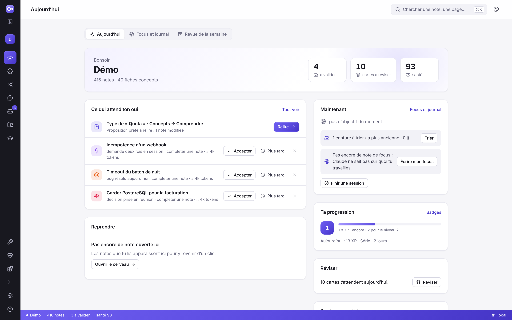
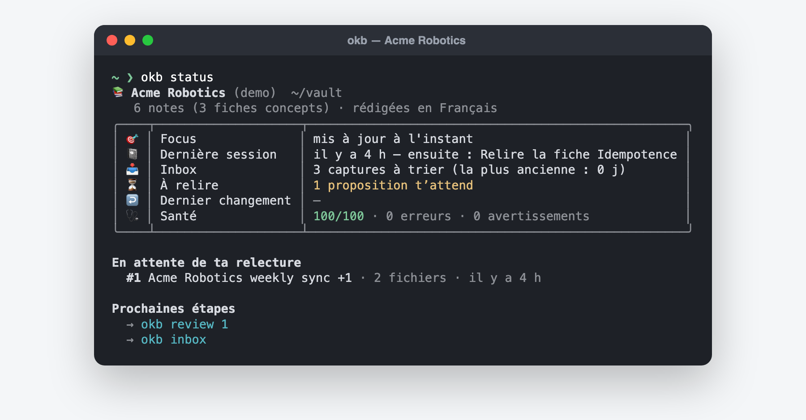
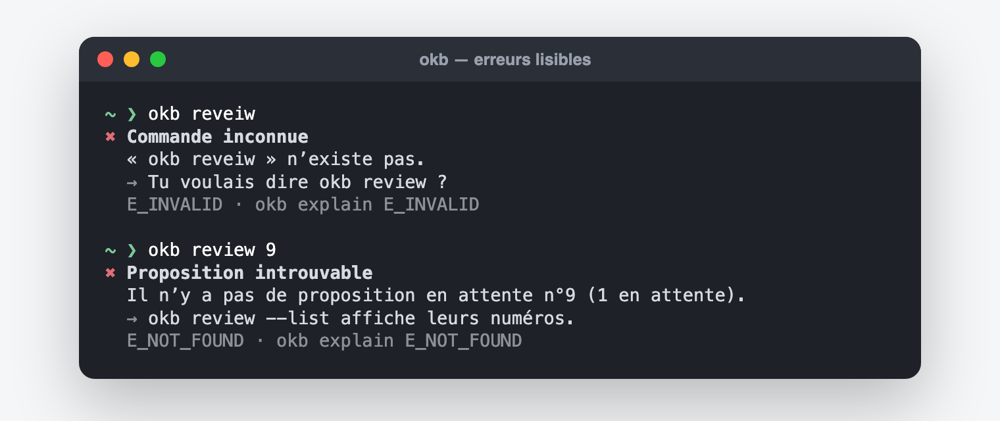
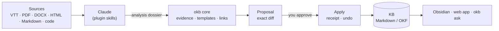
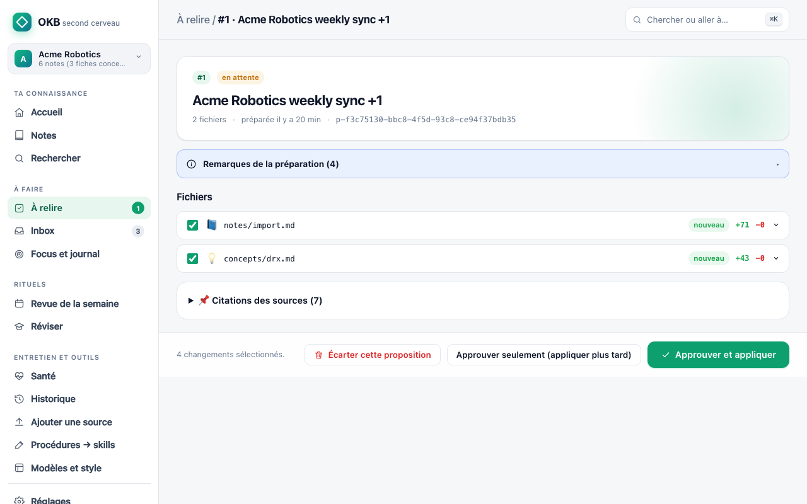
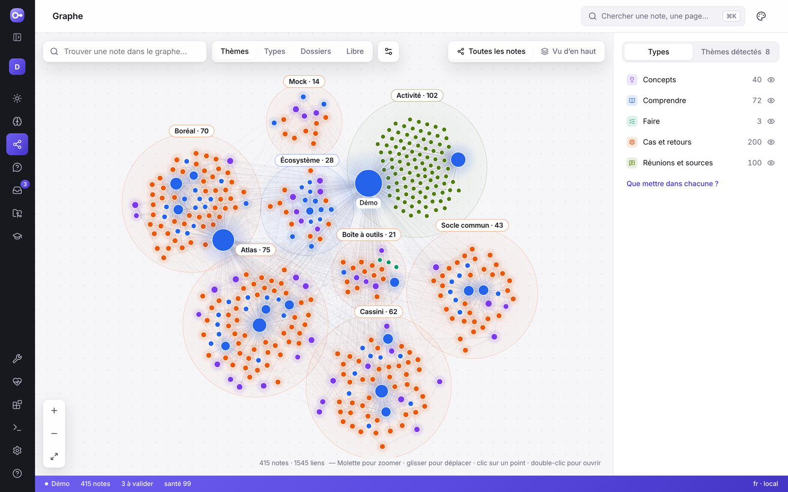

# OKB — Open Knowledge Brain · 1.5.0

**A local second brain for Claude Code and Obsidian, where nothing enters your
notes without your approval.**

Claude reads your sources (meeting transcripts, documents, web pages, code) and
writes the synthesis. A TypeScript core checks every sentence against an exact
quotation of its source, prepares a reviewable diff, and applies it only after
you approve, with a receipt you can roll back. The knowledge base stays a folder
of plain Markdown files on your computer, that you open in Obsidian or in the web app.

**En français :** [démarrer](DEMARRER.md) · [guide d’utilisation](docs/guide/README.md).



## Version 1.5: the web app becomes the product

- **A new web app** (React, served locally like before): one font, two themes
  (Atelier and Classique), light or dark, gradient or flat; every page of 1.0
  regrouped into thirteen destinations, each tab with its own address.
- **The Brain explorer**: a foldable tree by folders or by types, pinned and recent
  notes, saved views; cumulative filters (types, status, quality, date, 🔒); list,
  table or cards; several notes retyped or locked in one proposal.
- **Reading**: a concept's one-line definition in a bubble on hover or tap;
  translation on demand with a per-section cache and the cost said first.
- **Repositories**: a knowledge level out of 100 without AI, the system map
  computed from the code with a proof for each line, and a **knowledge exam** —
  Claude answers the onboarding questions from the notes only, graded against the
  code, a person's answer or the expected one.
- **Ask your brain**: search by meaning, then an answer that cites your notes.
- **Share without a server**: a pack of a subject's notes, compared and merged by
  a proposal (CLI and web app).
- **Modules** per profession, a stable person id and a role, personal XP and
  badges, OKB's own AI through Claude Code or an API key.

Details: [release notes 1.5.0](docs/releases/RELEASE-1.5.0.md) · guide (FR):
[l’application web](docs/guide/application-web.md),
[modules, niveau, examen, traduction et partage](docs/guide/modules-et-niveau.md).

## Version 1: you work, OKB suggests what to keep, files it, and brings it back

- **Brains** organised in five drawers, zoomed product → repository → ticket, with
  a 5-minute page per subject and a breadcrumb on every note. An address engine
  files ~90 kinds of note the same way every time.
- ✨ **Nothing is written without your yes.** Claude shows a suggestion card
  first — kind, exact place, why, what already exists, relevance, cost — and OKB
  records your answer itself. A daily budget keeps tokens in check.
- **Find in three seconds**: typos, accents, both languages, error messages, the
  notes about the file you opened; a graph by levels.
- **Templates and quality**: ~60 templates with perfect examples, Mermaid
  diagrams checked, a quality reviewer, scores out of 100 on every note.
- **The `okb-dev` module**: product, repository, ticket, explain, debug,
  pre-review with the team's rules, commit and PR text, support cases.
- **Learn and grow**: spaced review (FSRS) of your concept cards, a skills map,
  STAR achievements, one-on-one and annual review preparation, a portable career
  copy checked for company mentions.
- **Robust and private**: history without Git, trash, verified daily backups,
  🔒 notes Claude reads only when you name them, personal data flagged at review.
- `okb metrics` measures the 1.0 criteria on your own brain, locally.

Details: [release notes 1.0.0](docs/releases/RELEASE-1.0.0.md) · guide (FR):
[ton cerveau](docs/guide/cerveau.md), [rien sans ton oui](docs/guide/demander-avant-ecrire.md),
[le module développeur](docs/guide/module-developpeur.md).

## Three ways to use it

| | |
|---|---|
| **In Claude Code** | Just say it: “ok, end of session”, “read this transcript”, “what does my KB say about…”. OKB recognises the request and offers to take over, with a button to confirm. `/okb` opens its panel. |
| **In the browser** | `okb serve` opens a local web app that does everything the terminal does: read, search, review and approve, undo, capture, focus, weekly review, settings, several KBs. |
| **In the terminal** | `okb` alone opens a menu; every command asks what it needs, one question at a time, with a recommended answer. |

<p>
  
  
</p>



## A knowledge base for every code repository you work on

New on a repository and know nothing about it? In Claude Code, inside the
repository, type `/okb-dev:onboard` (or just say “I'm new to this repo”):

1. **A deterministic map in seconds** (`okb repo scan`, no AI, nothing executed):
   - stack and modules;
   - what the repository exposes and what it calls (services, routes, events,
     destinations, bindings, URLs, databases);
   - configuration, commands, CI, who changed what;
   - where the README disagrees with the code.
2. **A full reading**: Claude reads the docs, reading agents cover each area of
   the code, and the main flows are followed end to end. Every fact is checked
   word for word against the file it cites.
3. **25 onboarding questions**, each answered with `file:line` evidence or left
   visibly unknown with whom to ask. Seniors can answer them at any time.
4. **Seven notes in `repos/<id>/`**, approved like any proposal:
   - understand it in 10 minutes;
   - getting started;
   - architecture, with diagrams whose every box is tied to a real path;
   - code map;
   - interfaces;
   - delivery;
   - open questions.

**Three kinds of KB**: a subject, one code repository (its notes at the root), or
a team's repositories — a workspace. Say “set OKB up for me” in Claude Code (or
run `okb start`): it reads the folders around you, recommends one, shows the plan
and runs it once you agree.

**A whole team's repositories — a workspace.** `okb workspace add <folder>` maps
every repository of a folder into one KB, one space per repository plus a shared
part (business concepts, features across repositories, decisions, how the
repositories connect). OKB then narrows by itself to the repository and ticket
you name (“I have ticket ABC-123 on orders-service”): Claude gets a short brief
(its notes, the shared notes tied to it, its neighbours, the ticket), and
`okb ask` ranks that scope first. A ticket is followed without AI — branch,
commits, a journal of decisions and traps — and `/okb-dev:ticket` turns it into
cited updates at two levels: the repository's notes and the shared KB.
`okb repo update` tells which notes the code moved under. Company code goes into
a **confidential KB** that stays on your machine.
A repository with its own KB can stay attached to a workspace (it gets the shared
part) or be merged into it (`okb kb merge`). The web graph of a workspace shows it
from above: one disc per repository, how their code connects, the scope.
→ [Guide (FR)](docs/guide/repos.md) · [Workspace (FR)](docs/guide/espace-de-travail.md) · [Which organisation (FR)](docs/guide/choisir-son-organisation.md) · [Design](docs/dev/REPOS.md)

## Know what it costs, and whether it writes what you want

`okb usage` and the web app's **Usage** page read the logs Claude Code already
keeps on your machine. They show:
- what each OKB task costs (an import, an onboarding, a question), by model and
  subagent;
- what fills the context;
- how proposals fare: changes dropped at review, notes edited by hand afterwards.

Showing them spends no token. `okb feedback "…"` notes a problem when it happens.
`okb report` puts it all in one page, without your notes' text, to hand to Claude
to improve OKB.
→ [Guide (FR)](docs/guide/utilisation-et-couts.md) · [Cost and quality](docs/dev/COSTS.md)

## Why

AI assistants summarise well but make it easy to store claims nobody checked,
and every session starts from zero. OKB keeps the useful part — Claude's reading
and writing — and adds what a long-lived knowledge base needs:

- **Traceability.** Every claim carries a verbatim quotation located in its
  source; inferences are labelled as such; corrections stay visible.
- **Human approval.** Claude prepares; only you approve. A plugin hook stops the
  agent from approving its own proposals, and approving from the web app needs a
  confirmation on your screen. Applies are transactional, with backups and undo.
- **A shape that holds.** Note templates, a configurable writing style and
  one-minute concept cards keep hundreds of notes consistent and readable.
- **Memory between sessions.** A short focus note and a session journal, outside
  the KB, let each session start where the last one stopped.
- **Good neighbour.** OKB writes only in the KBs it created or that you adopted,
  and never steps in for another knowledge tool you use (a support agent's KB, a
  team wiki, an MCP server).

## Quick start

Node **22.13+**; [Claude Code](https://code.claude.com) and [Obsidian](https://obsidian.md) recommended.

```bash
git clone <this repository> okb && cd okb
./scripts/install.sh
```

The script builds OKB inside its folder. No KB is connected by default: the `okb
init` wizard asks whether to create one, under a name you choose, to connect an
existing folder of notes, or to wait. Then it offers the Claude Code plugin and
an `okb` command. Nothing outside the folder changes without a yes; Claude and
shell settings are never edited; no person's name is read. `--yes` installs OKB
without a KB.

No access to this repository? `npm pack` makes an `okb-x.y.z.tgz` to share:
`npm install -g okb-x.y.z.tgz`, then `okb update --from <newer.tgz>`.

An old KB or Obsidian vault: `okb kb add <folder>`, then `/okb:convert` in
Claude Code. It prepares one proposal that adds the missing front matter, makes
links portable and files each note by category, without rewriting a word.

Then:

```bash
okb            # what is waiting, and what to do next
okb tour       # a two-minute guided tour on a throwaway KB
okb serve      # the web app
okb doctor     # check everything; --fix repairs what it can
```

## Daily use

| Intent | Say it in Claude | Web app | Terminal |
|---|---|---|---|
| Jot something down, decide later | “note this: …” | Today · To review › Captures | `okb capture "…"` |
| Import a transcript, document, page or code | “read this transcript” | Tools › Add a source | via Claude |
| Find an answer in your notes | “what does my KB say about …” | Ask · ⌘K | `okb ask "…"` |
| Review and apply a proposal | “review the proposals” | To review › Proposals | `okb review` |
| Undo the last change | “undo the last change” | To review › History | `okb undo` |
| End a work session without losing anything | “ok, end of session” | Today › Focus and journal | `okb done` |
| Weekly review with spaced re-reading | “weekly review” | Today › Weekly review | `okb weekly` |
| Revise by active recall | “quiz me on this note” | Learn | `/okb:learn` |
| Get started on a code repository | “I'm new to this repo” · `/okb-dev:onboard` | Repos | `okb repo add` · `okb repo status` |
| Feed the repository's KB after a ticket | “I finished my ticket” · `/okb-dev:ticket` | Repos | `okb ticket done` · `okb repo update` |
| Work across a team's repositories | “I have ticket ABC-123 on orders-service” · `/okb-dev:workspace` | Repos | `okb workspace add` · `okb scope` · `okb ticket` |
| Turn a procedure into a Claude skill | “turn this procedure into a skill” | Tools › Procedures as skills | `okb skillify` |
| See all notes and how they connect | “show me my graph” | Graph | `okb categories` |
| Check and repair the KB | “check my KB” | Upkeep | `okb maintain` · `okb doctor` |
| Settings, languages, several KBs | — | Settings · brain switcher | `okb settings` · `okb kb` · `okb new` |





## Features

| | |
|---|---|
| **Ingest** | Transcripts, documents, pages and source code, alone or several per note; bounded extraction, nothing executed |
| **Evidence** | Claims backed by exact quotes; teaching aids (explanation, analogy with its limits, Mermaid diagram, example) tied to the claims they rephrase |
| **Graph & categories** | Every note and link in a living graph, coloured by kind (concepts, guides, how-tos, processes, cases, decisions, meetings, learning paths); local graph under each note; exact backlinks; categories per KB in `.okb/categories.yaml` |
| **Code repositories** | Deterministic map, reading plan, 25 onboarding questions, notes cited at the line, diagrams tied to real paths, freshness against Git, ticket follow-up, multi-repository landscape, confidential KBs |
| **Templates** | Guide, concept, procedure, tutorial, process, tool, automation, experience, client case, decision, meeting, learning path, and seven repository templates — fixed sections, headings and order |
| **Style** | Presets `standard`, `pedagogique`, `expert` plus eight knobs and a reader level; a style change never rewrites existing notes |
| **Languages** | Interface in French or English (automatic by default); notes written in French, English, Spanish, German, Italian or Portuguese, per KB |
| **Review & apply** | Exact diffs, partial selection, signed approval, path policy, lock, receipts, undo (OKB never commits or pushes a KB) |
| **Second-brain rituals** | Private inbox, weekly review with spaced re-reading (J+1, 7, 30, 90), active recall, focus note and end-of-session journal |
| **Natural language** | A prompt hook recognises OKB requests in plain French or English and offers the matching command; it stays silent for other tools' knowledge bases |
| **Keeping the thread** | Projects (where each stands, its next step), actions and what you wait for (spotted in a line you type, with its date, no AI), a journal by day and by project, “where I was” prepared when you leave a project, and a Today screen that answers six questions |
| **Terminal assistants (MCP)** | `okb mcp` lets Claude Code, Codex, Copilot or Cursor search and read your notes and suggest new ones, with the same engine as the app and the CLI; 🔒 notes stay hidden and approval stays yours |
| **Web app** | Local only; five screens (Today, Projects, Memory, Assistant, Progress), “Keep this” and “To decide” on every screen; light and dark themes, keyboard palette, readable on a phone |
| **Errors that help** | Every error says what happened, why, and what to do; `okb explain <code>` |
| **Maintenance** | Broken links, ambiguous concepts, stale notes, style and template drift, secrets in notes, link-preserving moves |
| **Safety** | Credentials refused everywhere; organisation and team overlays can only narrow what a profile allows |

## How it works

A source follows: bounded extraction → analysis dossier written by Claude →
search of the existing KB → proposal → independent evidence review (a subagent)
→ human approval → transactional apply.

- **The core never calls a language model.** It validates what Claude produced:
  every evidence quote must exist in the normalised source, every aid must rest on
  claims, every link must resolve, every note must follow its template.
- **Proposals are content-addressed.** The approval signs the exact selection and
  hash; apply recomputes both, checks file baselines, writes backups and the
  expected output first, then the notes.
- **The KB is plain files.** Storage targets the [Open Knowledge Format 0.2](docs/dev/OKF-CONFORMANCE.md):
  YAML frontmatter, relative Markdown links with `.md`, unknown fields preserved.
  Search is lexical (titles, aliases, headings, excerpts); no vector database.

| Location | Holds |
|---|---|
| This repository | Generic code, plugin, web app, fictitious tests, example settings |
| `~/.okb/` | Your settings and, per KB, the private state: proposals, approvals, receipts, backups, inbox |
| Each KB folder | Your notes, local, marked as OKB's by `.okb/owner.yaml` |
| Beside your KBs | The focus note and the session journal |

## Several knowledge bases

One Obsidian vault, one folder per KB — same name everywhere:

```
second-brain/            ← Obsidian vault
├── 00 Home.md            hand-written, links every KB
├── 01 Focus.md           focus note shared by the KBs
├── journal/              session journal
├── kb-work/              KB "work"
└── kb-project-x/         KB "project-x"
```

Separate KBs when sharing, confidentiality or reader level differ; otherwise one
KB with folders, so notes link to each other. Two KBs never share a folder.

## Supported inputs

VTT captions with timecodes and speakers; Markdown and text; static HTML or
explicitly allowed public URLs; PDF text layers; DOCX body text; source and
configuration files read as text with line ranges and top-level symbols.
Scanned PDFs, JavaScript-only pages and unsupported document parts are reported
as absent. No audio transcription, OCR or browser automation is bundled.

## Quality

```bash
npm run release:check   # typecheck, tests, plugin checks, clean packed install with a fictitious workflow
claude plugin validate ./plugin --strict
```

310+ regression tests cover evidence validation, proposals, apply and undo,
concurrency, path policy, links, templates, style, secrets, inbox, weekly review,
focus and journal, languages, intent recognition, KB ownership, the setup wizard
and the web app's security guarantees. Claude's own skill selection and writing
quality are measured separately with the [evaluation suite](docs/dev/EVALUATION.md).

Limits, stated plainly: the approval guards protect against an agent calling
commands or the web API, not against software that controls your mouse and
keyboard; search is lexical; a group of files is recoverable, not a single
filesystem transaction.

## Documentation

- **User guide (French):** [start](docs/guide/README.md) ·
  [install](docs/guide/installer.md) · [daily use](docs/guide/au-quotidien.md) ·
  [web app](docs/guide/application-web.md) · [settings](docs/guide/reglages.md) ·
  [troubleshooting](docs/guide/depannage.md)
- **Developers:** [architecture](docs/dev/ARCHITECTURE.md) ·
  [decisions](docs/dev/DECISIONS.md) · [workflows](docs/dev/WORKFLOWS.md) ·
  [web app](docs/dev/WEB-APP.md) · [security](docs/dev/SECURITY.md) ·
  [templates](docs/dev/TEMPLATES.md) · [style](docs/dev/STYLE.md) ·
  [installation details](docs/dev/INSTALL.md) · [context budget](docs/dev/CONTEXT.md) · [cost and quality](docs/dev/COSTS.md) ·
  [Claude compatibility](docs/dev/CLAUDE-COMPATIBILITY.md) · [evaluation](docs/dev/EVALUATION.md)
- **Release notes:** [1.5.0](docs/releases/RELEASE-1.5.0.md) · [1.0.0](docs/releases/RELEASE-1.0.0.md) · [0.11.0](docs/releases/RELEASE-0.11.0.md) · [0.10.0](docs/releases/RELEASE-0.10.0.md) · [0.9.0](docs/releases/RELEASE-0.9.0.md) · [0.8.0](docs/releases/RELEASE-0.8.0.md) · [0.7.0](docs/releases/RELEASE-0.7.0.md) · [0.6.0](docs/releases/RELEASE-0.6.0.md) · [0.5.0](docs/releases/RELEASE-0.5.0.md) ·
  [0.4.0](docs/releases/RELEASE-0.4.0.md) · [0.3.0](docs/releases/RELEASE-0.3.0.md) ·
  [0.2.0](docs/releases/RELEASE-0.2.0.md)

## License

[MIT](LICENSE)
