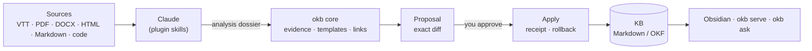

# OKB — Open Knowledge Brain · 0.4.0

**A local second brain for Claude Code and Obsidian, where nothing enters your
notes without your approval.**

Claude reads your sources (meeting transcripts, documents, web pages, code) and
writes the synthesis. A TypeScript core checks every sentence against an exact
quotation of its source, prepares a reviewable diff, and applies it only after
you approve, with a receipt you can roll back. The knowledge base stays a folder
of plain Markdown files that you open in Obsidian and version with Git.

**Démarrer en français :** [DEMARRER.md](DEMARRER.md).



## Why

AI assistants summarise well but make it easy to store claims nobody checked,
and every session starts from zero. OKB keeps the useful part — Claude's reading
and writing — and adds what a long-lived knowledge base needs:

- **Traceability.** Every claim carries a verbatim quotation located in its
  source; inferences are labelled as such; corrections and contradictions stay
  visible.
- **Human approval.** Claude prepares; only you approve (a plugin hook stops the
  agent from approving its own proposals). Applies are transactional, with
  backups and rollback.
- **A shape that holds.** Note templates, a configurable writing style and
  one-minute concept cards keep hundreds of notes consistent and readable.
- **Memory between sessions.** A short focus note and a session journal, outside
  the KB, let each session start where the last one stopped.

## Features

| | |
|---|---|
| **Ingest** | Transcripts, documents, pages and source code, alone or several per note; bounded extraction, nothing executed |
| **Evidence** | Claims backed by exact quotes; teaching aids (explanation, analogy with its limits, Mermaid diagram, example) tied to the claims they rephrase |
| **Templates** | Guide, concept, procedure, process, tool, automation, experience, decision, meeting — fixed sections, headings and order |
| **Style** | Presets `standard`, `pedagogique`, `expert` plus eight knobs, reader level per domain; a style change never rewrites existing notes |
| **Concept cards** | Definition in one sentence, analogy and its limit, how it works, example, diagram, pitfalls, quotation; automatic links with aliases |
| **Review & apply** | Exact diffs, partial selection, signed approval, path policy, lock, receipts, rollback, optional Git commit per apply |
| **Second-brain rituals** | Private inbox (`capture`), weekly review with spaced re-reading (J+1, 7, 30, 90), active recall (`learn`), focus note and end-of-session journal (`done`) |
| **From process to skill** | `okb skillify` turns a procedure or process note into a Claude Code skill draft, refined with you and tested |
| **Maintenance** | Broken links, ambiguous concepts, stale notes, style and template drift, secrets in notes, link-preserving moves |
| **Local reader** | `okb serve`: notes, search, proposals and their exact previews in the browser, read-only |
| **Safety** | Credentials refused everywhere (`E_SECRET`); organisation and team overlays can only narrow what a profile allows |

## Quick start

Node **22.12+**, npm, and [Claude Code](https://code.claude.com).

```bash
git clone <this repository> okb && cd okb
npm ci
npm run build
npm link                      # puts `okb` on your PATH
okb version
```

Create a profile for an existing or empty KB folder:

```bash
okb setup --profile notes --kb-root ~/Notes/kb-notes --concept-assist targeted \
  --answer-language en --human-actor human:me --writing-preset standard
okb doctor
```

Install the Claude Code plugin for every session (terminal and desktop app):

```bash
claude plugin marketplace add "$PWD"
claude plugin install okb@okb
```

Then, in Claude: `/okb:setup` for a guided setup (one question at a time),
`/okb:ingest` with a file, `/okb:review`, and ask questions in plain language.
For a one-off session without installing: `claude --plugin-dir "$PWD/plugin"`.

## Daily use

| Intent | In Claude | In the terminal |
|---|---|---|
| Tell Claude what you work on now | `/okb:focus` | `okb focus init` · `okb focus set "…"` |
| Import a transcript, document, page or code | `/okb:ingest` | `okb ingest …` (Claude writes the dossier) |
| Find an answer in your notes | `/okb:ask` or just ask | `okb ask "…"` |
| Review and apply a proposal | `/okb:review` · `/okb:apply` | `okb review <id> --diff` · `okb review <id> --approve` · `okb apply <id>` |
| Jot something down, decide later | `/okb:capture …` | `okb capture "…"` |
| Triage the inbox, one item at a time | `/okb:inbox` | `okb inbox` |
| End a work session without losing anything | `/okb:done` | `okb done --summary "…" --keep "…" --next "…"` |
| Weekly review | `/okb:weekly` | `okb weekly` |
| Revise a note by active recall | `/okb:learn …` | — |
| Turn a procedure into a skill | `/okb:skillify …` | `okb skillify <note> --out .claude/skills` |
| Rewrite one note in another style | `/okb:revise` | `okb revise …` |
| Audit, organise, move notes | `/okb:maintain` | `okb maintain` · `okb links move a b` · `okb nav` |
| Which profile and KB am I using? | every skill starts with `📚 KB: <profile>` | `okb profile` · `okb setup switch <id>` |
| Read in the browser | — | `okb serve` |

Approval is always yours: run `okb review <id> --approve` yourself, in your
terminal. Every apply prints the command that undoes it.

## How it works

A source follows: bounded extraction → analysis dossier written by Claude →
search of the existing KB → proposal → independent evidence review (a subagent)
→ human approval → transactional apply.

- **The core never calls a language model.** It validates what Claude produced:
  every evidence quote must exist in the normalised source, every aid must rest on
  claims, every link must resolve, every note must follow its template.
- **Proposals are content-addressed.** The approval signs the exact selection and
  hash; apply recomputes both, checks file baselines, writes backups and the
  expected output first, then the notes. Per-file writes are atomic; a group of
  files is recoverable through its receipt.
- **The KB is plain files.** Storage targets the [Open Knowledge Format 0.2](docs/OKF-CONFORMANCE.md):
  YAML frontmatter, relative Markdown links with `.md`, unknown fields preserved.
  Search is lexical (titles, aliases, headings, excerpts); no vector database.

| Location | Holds |
|---|---|
| This repository | Generic code, plugin, fictitious tests, example settings |
| `~/.okb/profiles/<id>/profile.yaml` | Private preferences and the KB location |
| `kb.root` | Your notes — a separate folder, versionable on its own |
| Profile `state/`, outside the KB | Source snapshots, proposals, approvals, receipts, backups, inbox, journal |

Preference order: defaults → organisation → team → profile → KB-local →
environment → flags. Policies accumulate restrictions instead of following
last-write-wins.

## Organising several knowledge bases

One Obsidian vault, one folder per KB, one profile per KB — same name everywhere:

```
second-brain/            ← Obsidian vault
├── 00 Home.md            hand-written, links every KB
├── Focus.md              focus note shared by the profiles
├── kb-work/              profile "work"   · Git repo kb-work
└── kb-project-x/         profile "project-x" · Git repo kb-project-x
```

Separate KBs when sharing, confidentiality or reader level differ; otherwise one
KB with folders, so notes link to each other. With `git.autoCommit: true`, each
apply becomes one commit of exactly the files it wrote; pushing stays manual.

## Supported inputs

VTT captions with timecodes and speakers; Markdown and text; static HTML or
explicitly allowed public URLs; PDF text layers; DOCX body text; source and
configuration files read as text with line ranges and top-level symbols
(TypeScript, Python, SQL, Prisma, GraphQL, Protocol Buffers…). Scanned PDFs,
JavaScript-only pages and unsupported document parts are reported as absent. No
audio transcription, OCR or browser automation is bundled.

## Quality

```bash
npm run release:check   # typecheck, tests, plugin checks, clean packed install with a fictitious workflow
claude plugin validate ./plugin
```

280+ regression tests cover evidence validation, proposals, apply and
rollback, concurrency, path policy, links, templates, style, secrets, inbox,
weekly review, focus and journal, skill drafts and Git commits. Claude's own skill
selection and writing quality are measured separately with the
[evaluation suite](docs/EVALUATION.md), in your authenticated runtime.

Limits, stated plainly: the approval hook is a best-effort guard inside Claude
Code, not isolation from same-account shell access; search is lexical; a group of
files is recoverable, not a single filesystem transaction.

## Documentation

[Architecture](docs/ARCHITECTURE.md) · [Decisions](docs/DECISIONS.md) ·
[Workflows](docs/WORKFLOWS.md) · [Templates](docs/TEMPLATES.md) ·
[Style](docs/STYLE.md) · [Installation](docs/INSTALL.md) ·
[Security](docs/SECURITY.md) · [Context budget](docs/CONTEXT.md) ·
[Local reader](docs/LOCAL-READER.md) · [OKF conformance](docs/OKF-CONFORMANCE.md) ·
[Claude compatibility](docs/CLAUDE-COMPATIBILITY.md) · [Evaluation](docs/EVALUATION.md) ·
Release notes: [0.4.0](docs/RELEASE-0.4.0.md), [0.3.0](docs/RELEASE-0.3.0.md), [0.2.0](docs/RELEASE-0.2.0.md).

Most design documents are written in French.

## License

[MIT](LICENSE)
