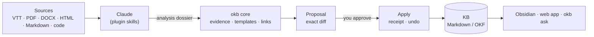

# OKB — Open Knowledge Brain · 0.5.0

**A local second brain for Claude Code and Obsidian, where nothing enters your
notes without your approval.**

Claude reads your sources (meeting transcripts, documents, web pages, code) and
writes the synthesis. A TypeScript core checks every sentence against an exact
quotation of its source, prepares a reviewable diff, and applies it only after
you approve, with a receipt you can roll back. The knowledge base stays a folder
of plain Markdown files that you open in Obsidian and version with Git.

**En français :** [démarrer](DEMARRER.md) · [guide d’utilisation](docs/guide/README.md).


## Three ways to use it

| | |
|---|---|
| **In Claude Code** | Just say it: “ok, end of session”, “read this transcript”, “what does my KB say about…”. OKB recognises the request and offers to take over, with a button to confirm. `/okb` opens its panel. |
| **In the browser** | `okb serve` opens a local web app that does everything the terminal does: read, search, review and approve, undo, capture, focus, weekly review, settings, several KBs. |
| **In the terminal** | `okb` alone opens a menu; every command asks what it needs, one question at a time, with a recommended answer. |



## Why

AI assistants summarise well but make it easy to store claims nobody checked,
and every session starts from zero. OKB keeps the useful part — Claude's reading
and writing — and adds what a long-lived knowledge base needs:

- **Traceability.** Every claim carries a verbatim quotation located in its
  source; inferences are labelled as such; corrections stay visible.
- **Human approval.** Claude prepares; only you approve. A plugin hook stops the
  agent from approving its own proposals, and approving from the web app needs a
  confirmation on your screen. Applies are transactional, with backups and undo.
- **A shape that holds.** Note templates, a configurable writing style and
  one-minute concept cards keep hundreds of notes consistent and readable.
- **Memory between sessions.** A short focus note and a session journal, outside
  the KB, let each session start where the last one stopped.
- **Good neighbour.** OKB writes only in the KBs it created or that you adopted,
  and never steps in for another knowledge tool you use (a support agent's KB, a
  team wiki, an MCP server).

## Quick start

Node **22.12+**; [Claude Code](https://code.claude.com) and [Obsidian](https://obsidian.md) recommended.

```bash
git clone <this repository> okb && cd okb
./scripts/install.sh
```

The script builds OKB inside its folder, then the `okb init` wizard asks, one
question at a time: the KB name, its folder, the interface and writing languages,
the writing style, Git history, and whether to install the Claude Code plugin and
an `okb` command. Nothing outside the folder changes without a yes; Claude and
shell settings are never edited. `--yes` accepts every recommendation.

Then:

```bash
okb            # what is waiting, and what to do next
okb tour       # a two-minute guided tour on a throwaway KB
okb serve      # the web app
okb doctor     # check everything; --fix repairs what it can
```

## Daily use

| Intent | Say it in Claude | Web app | Terminal |
|---|---|---|---|
| Jot something down, decide later | “note this: …” | Home · Inbox | `okb capture "…"` |
| Import a transcript, document, page or code | “read this transcript” | Add a source | via Claude |
| Find an answer in your notes | “what does my KB say about …” | Search · ⌘K | `okb ask "…"` |
| Review and apply a proposal | “review the proposals” | To review | `okb review` |
| Undo the last change | “undo the last change” | History | `okb undo` |
| End a work session without losing anything | “ok, end of session” | Focus & journal | `okb done` |
| Weekly review with spaced re-reading | “weekly review” | Weekly review | `okb weekly` |
| Revise by active recall | “quiz me on this note” | Revise | `/okb:learn` |
| Turn a procedure into a Claude skill | “turn this procedure into a skill” | Procedures → skills | `okb skillify` |
| Check and repair the KB | “check my KB” | Health · Diagnostics | `okb maintain` · `okb doctor` |
| Settings, languages, several KBs | — | Settings · KB switcher | `okb settings` · `okb kb` · `okb new` |


## Features

| | |
|---|---|
| **Ingest** | Transcripts, documents, pages and source code, alone or several per note; bounded extraction, nothing executed |
| **Evidence** | Claims backed by exact quotes; teaching aids (explanation, analogy with its limits, Mermaid diagram, example) tied to the claims they rephrase |
| **Templates** | Guide, concept, procedure, process, tool, automation, experience, decision, meeting — fixed sections, headings and order |
| **Style** | Presets `standard`, `pedagogique`, `expert` plus eight knobs and a reader level; a style change never rewrites existing notes |
| **Languages** | Interface in French or English (automatic by default); notes written in French, English, Spanish, German, Italian or Portuguese, per KB |
| **Review & apply** | Exact diffs, partial selection, signed approval, path policy, lock, receipts, undo, optional Git commit per apply |
| **Second-brain rituals** | Private inbox, weekly review with spaced re-reading (J+1, 7, 30, 90), active recall, focus note and end-of-session journal |
| **Natural language** | A prompt hook recognises OKB requests in plain French or English and offers the matching command; it stays silent for other tools' knowledge bases |
| **Web app** | Local only, every terminal feature, light and dark themes, keyboard palette, readable on a phone |
| **Errors that help** | Every error says what happened, why, and what to do; `okb explain <code>` |
| **Maintenance** | Broken links, ambiguous concepts, stale notes, style and template drift, secrets in notes, link-preserving moves |
| **Safety** | Credentials refused everywhere; organisation and team overlays can only narrow what a profile allows |

## How it works

A source follows: bounded extraction → analysis dossier written by Claude →
search of the existing KB → proposal → independent evidence review (a subagent)
→ human approval → transactional apply.

- **The core never calls a language model.** It validates what Claude produced:
  every evidence quote must exist in the normalised source, every aid must rest on
  claims, every link must resolve, every note must follow its template.
- **Proposals are content-addressed.** The approval signs the exact selection and
  hash; apply recomputes both, checks file baselines, writes backups and the
  expected output first, then the notes.
- **The KB is plain files.** Storage targets the [Open Knowledge Format 0.2](docs/dev/OKF-CONFORMANCE.md):
  YAML frontmatter, relative Markdown links with `.md`, unknown fields preserved.
  Search is lexical (titles, aliases, headings, excerpts); no vector database.

| Location | Holds |
|---|---|
| This repository | Generic code, plugin, web app, fictitious tests, example settings |
| `~/.okb/` | Your settings and, per KB, the private state: proposals, approvals, receipts, backups, inbox |
| Each KB folder | Your notes — versionable on its own, marked as OKB's by `.okb/owner.yaml` |
| Beside your KBs | The focus note and the session journal |

## Several knowledge bases

One Obsidian vault, one folder per KB — same name everywhere:

```
second-brain/            ← Obsidian vault
├── 00 Home.md            hand-written, links every KB
├── 01 Focus.md           focus note shared by the KBs
├── journal/              session journal
├── kb-work/              KB "work"      · its own Git repository
└── kb-project-x/         KB "project-x" · its own Git repository
```

Separate KBs when sharing, confidentiality or reader level differ; otherwise one
KB with folders, so notes link to each other. Two KBs never share a folder.

## Supported inputs

VTT captions with timecodes and speakers; Markdown and text; static HTML or
explicitly allowed public URLs; PDF text layers; DOCX body text; source and
configuration files read as text with line ranges and top-level symbols.
Scanned PDFs, JavaScript-only pages and unsupported document parts are reported
as absent. No audio transcription, OCR or browser automation is bundled.

## Quality

```bash
npm run release:check   # typecheck, tests, plugin checks, clean packed install with a fictitious workflow
claude plugin validate ./plugin --strict
```

310+ regression tests cover evidence validation, proposals, apply and undo,
concurrency, path policy, links, templates, style, secrets, inbox, weekly review,
focus and journal, languages, intent recognition, KB ownership, the setup wizard
and the web app's security guarantees. Claude's own skill selection and writing
quality are measured separately with the [evaluation suite](docs/dev/EVALUATION.md).

Limits, stated plainly: the approval guards protect against an agent calling
commands or the web API, not against software that controls your mouse and
keyboard; search is lexical; a group of files is recoverable, not a single
filesystem transaction.

## Documentation

- **User guide (French):** [start](docs/guide/README.md) ·
  [install](docs/guide/installer.md) · [daily use](docs/guide/au-quotidien.md) ·
  [web app](docs/guide/application-web.md) · [settings](docs/guide/reglages.md) ·
  [troubleshooting](docs/guide/depannage.md)
- **Developers:** [architecture](docs/dev/ARCHITECTURE.md) ·
  [decisions](docs/dev/DECISIONS.md) · [workflows](docs/dev/WORKFLOWS.md) ·
  [web app](docs/dev/WEB-APP.md) · [security](docs/dev/SECURITY.md) ·
  [templates](docs/dev/TEMPLATES.md) · [style](docs/dev/STYLE.md) ·
  [installation details](docs/dev/INSTALL.md) · [context budget](docs/dev/CONTEXT.md) ·
  [Claude compatibility](docs/dev/CLAUDE-COMPATIBILITY.md) · [evaluation](docs/dev/EVALUATION.md)
- **Release notes:** [0.5.0](docs/releases/RELEASE-0.5.0.md) ·
  [0.4.0](docs/releases/RELEASE-0.4.0.md) · [0.3.0](docs/releases/RELEASE-0.3.0.md) ·
  [0.2.0](docs/releases/RELEASE-0.2.0.md)

## License

[MIT](LICENSE)
