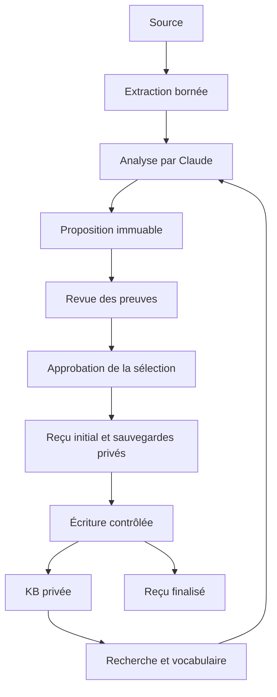

# Architecture et décisions

## Frontières de responsabilité

Le plugin orchestre le travail intellectuel dans Claude. Le CLI s’occupe des
opérations reproductibles. Obsidian reste un lecteur/éditeur des fichiers ; il
n’est pas nécessaire pour exécuter les tests. Aucun MCP n’est requis par défaut.

Le dossier d’analyse porte les blocs déclarés lus, les affirmations rapportées ou
déduites et leurs extraits exacts. Le noyau vérifie les identifiants et les citations ;
le réviseur évalue si elles soutiennent réellement le texte. Aucun test structurel
ne transforme une affirmation en fait techniquement vérifié.

## Modules

| Module | Contrat |
|---|---|
| `sources/` | acquisition limitée, adaptateurs, blocs normalisés et localisateurs |
| `pipeline/analysis.ts` | dossier v1/v2, couverture déclarée sur toutes les sources, identité des extraits, aides reliées aux affirmations, rendu stylé |
| `kb/`, `concepts/` | recherche locale, alias, sens, propositions de définitions et de liens |
| `proposal/` | contenu exact, dépendances, sélection, hash recalculable, validation, combinaison de propositions |
| `apply/` | autorisation, limites de chemin, verrou, préparation durable, reprise et rollback |
| `config/`, `setup/` | profils privés, précédence, restrictions cumulées |
| `okf/`, `links/`, `markdown/` | format ouvert, références relatives, modifications par positions AST |
| `nav/`, `migrate/`, `maintain/` | opérations d’entretien utilisant le même contrat de proposition |
| `style/` | préréglages, résolution par couches et demande ponctuelle, brief de rédaction, libellés fixes |
| `templates/` | modèles de notes (sections, ordre, titres, consignes), surcharges par KB |
| `categories/` | catégories de notes (couleur, emoji, modèles, types, dossiers), déduites sans rien écrire ; surcharges `.okb/categories.yaml` ; changement par proposition |
| `kb/graph.ts` | le graphe de la KB : nœuds, liens exacts (Markdown analysé), prérequis, rétroliens, comptes par catégorie |
| `revise/` | révision du style d’une note : éléments protégés, frontmatter, proposition de remplacement |
| `engine/` | les opérations écrites une fois (entrée validée, module, effet), `invoke`, et `okb mcp` pour les assistants |
| `projects/` | le Projet, les actions, le journal, « Où j'en étais », Aujourd'hui ; les sources que les modules déclarent (`sources.ts`) |
| `state/db.ts` | l'état opérationnel dans SQLite (`okb.db`, par profil, hors des notes) |
| `modules/wire.ts` | le seul fichier qui connaît tous les modules : chacun y déclare ce qu'il apporte au cœur |
| `web/` | lecteur local sans mutations : notes, recherche, propositions exactes, style et audit |
| `security/` | détection des secrets (clés, jetons, identifiants) dans propositions, captures, focus et notes |
| `inbox/`, `weekly/` | inbox privée hors KB, revue hebdomadaire en lecture seule avec relectures espacées |
| `focus/` | note de focus et journal des sessions, hors KB ; contexte donné au démarrage d’une session |
| `skillify/` | brouillon de skill Claude Code à partir d’une note procédure, process ou automatisation |
| `repo/` | repos de code : carte déterministe, plan de lecture, 25 questions d’onboarding, dossier v3 cité à la ligne, fraîcheur Git, ticket, paysage multi-repos, confidentialité (voir [REPOS.md](REPOS.md)) |
| `plugin/` | quatorze skills, dix-neuf commandes, trois agents, trois hooks (garde d’approbation, focus et repo au démarrage, intentions) et `bin/okb` |

## Un seul moteur

Une action d'OKB s'écrit une fois, comme opération (`src/engine/`, D58), avec son
module, son effet (`read`, `state`, `propose`) et son entrée validée par zod.
`invoke` la lance pour le web, la CLI et `okb mcp`. Le contexte dit qui demande :
un agent (Claude par la CLI, un assistant par MCP) ne voit jamais une note 🔒.
Approuver, appliquer et décider d'une carte ne sont pas des opérations.

Un module éteint masque ses opérations. `tests/module-boundary.test.ts` interdit
au cœur d'importer le code du module développeur (`repo/`, `work/`, `arch/`,
`dev/`, `knowledge/`), sauf une dette listée qui ne peut que diminuer.

## Les documents

Un fichier que la personne garde va tel quel dans `_Documents/<année>/` (D61,
`src/documents/`). C'est la seule écriture directe dans le dossier des notes, et
elle est réservée à la personne. Le chargeur de KB ignore ce dossier : un
document n'est pas une note. La liste et le texte lu (FTS5) sont dans `okb.db`.

## Les espaces

Chaque cerveau est dans Mon bagage ou dans Travail (`src/spaces/space.ts`, D62).
Le seul pont est `keepInBaggage` (`src/spaces/baggage.ts`) : il lit une note de
travail, retire ce que `src/spaces/details.ts` reconnaît du lieu de travail,
revérifie le texte final et prépare une proposition dans le bagage. Les packs
refusent le bagage dans les deux sens.

## Le oui

Ce que la personne écrit (captures, journal, actions, documents) est direct.
Ce qu'un assistant prépare attend : `eveningView` (`src/evening/evening.ts`)
rassemble les cartes et les changements, `sayYes` approuve un lot après une seule
confirmation de présence. `sayYes` n'est pas une opération du moteur.

## Les moments d'une conversation

Le hook de fin de réponse passe à `okb suggest moment` le dernier échange, les
messages précédents de la personne et l'identifiant de session. Le repérage
(`src/suggest/moments.ts`) est une fonction pure, sans IA. Les règles d'une
session (`src/suggest/session.ts`) décident quoi proposer : rien en cours de
route, trois choses au plus à la clôture, « pas maintenant » retenu (D61).

## Lire une KB par révision

Toute requête commence par `loadBundle` (D57). Une KB inchangée ne coûte que la
liste de ses fichiers et leurs tampons (inode, taille, dates) : le même objet
`Bundle` revient, et les vues qui en dérivent (index de recherche, scores) restent
valables tant qu'il est le même. Seules les notes changées sont relues. L'analyse
du Markdown d'un texte (liens, ancres, titres) est faite une fois et partagée
(`bodyFacts`). L'application d'une proposition relit le disque (`fresh`).

`npm run bench:speed` mesure la vitesse sur des cerveaux fictifs de 415 à 4 715
notes, sans IA. Cible de la 2.0 : une recherche répétée sous 200 ms au p95 à
5 000 notes.

## Choix assumés

**Fichiers avant base vectorielle.** Les notes restent lisibles, diffables et
transportables. La recherche actuelle est lexicale, avec titres, alias, rubriques
et extraits. Claude peut reformuler une recherche. Un index sémantique pourra être
ajouté comme cache dérivé, jamais comme source canonique. Aucune promesse de rappel
sémantique universel n’est faite pour cette version.

**Configuration plutôt que forks personnels.** Les profils portent le domaine,
la langue et le niveau d’assistance. Une couche équipe est distincte de la couche
organisation. Les listes d’interdiction s’unissent ; chaque groupe d’autorisation
d’écriture doit accepter le chemin ; les plafonds prennent le minimum. Les
préférences ne rétablissent pas une permission interdite par une couche supérieure.
Un profil demeure modifiable par le propriétaire de la machine : ce n’est pas un
service d’administration central avec identité forte.

**Sources complètes, sorties bornées.** Les blocs trop longs sont fractionnés sans
perte de texte. Les pages respectent un budget estimé et un curseur. Le snapshot
normalisé est conservé hors KB ; `--run` le réutilise sans relire le réseau. Le
curseur signifie « livré au caller ». La couverture sémantique est déclarée dans
le dossier puis contrôlée par revue, pas déduite du nombre de tokens envoyés.

**Le style est un paramètre, pas une réécriture.** Le brief est généré à la
demande depuis quelques valeurs du profil ; le style utilisé est figé dans le
dossier et dans `x_okb.writing`. Les faits restent des affirmations sourcées ;
les analogies, schémas et exemples sont des aides rattachées à ces affirmations.
Voir [STYLE.md](STYLE.md).

**Des modèles pour que la KB reste lisible en grandissant.** Chaque note suit un
modèle (guide, concept, procédure, retour d’expérience, décision, réunion) qui
fixe ses sections et leurs titres ; le CLI refuse un dossier qui s’en écarte. Voir
[TEMPLATES.md](TEMPLATES.md).

**Propositions avant mutations.** Import, navigation, migration et déplacement
produisent le même objet. Un déplacement est un groupe indivisible. Le hash porte
sur le contenu, les preuves, dépendances, profil et KB. Une approbation vise la
sélection exacte. La sélection modifie le résultat : une approbation de tous les
changements ne vaut donc pas pour n’importe quel sous-ensemble.

**Écritures récupérables.** Tous les résultats sont matérialisés et contrôlés avant
la première mutation. Sauvegardes et contenus attendus utilisent des noms dérivés
du hash du chemin, sans collisions entre `a/b.md` et `a__b.md`. Un reçu incomplet
existe avant l’écriture. Au redémarrage, chaque fichier doit correspondre à son
état initial ou à son résultat attendu ; la reprise reconnaît même le crash situé
entre `rename()` et le journal. L’annulation précontrôle tous les fichiers et
refuse les modifications ultérieures. Les fichiers sont atomiques séparément,
mais un lecteur externe peut observer un lot partiellement appliqué.

L’état de départ est revérifié pendant la préparation des écritures : une
édition Obsidian entre le contrôle initial et la lecture à sauvegarder n’est pas
adoptée silencieusement comme nouvelle référence. La reprise revalide le résultat
structurel et les liens sur la KB courante avant ses prochains fichiers.

**Fraîcheur sur demande.** L’entretien peut comparer une référence locale à son
empreinte d’ingestion à partir des métadonnées privées déjà présentes. Il ne
recontacte pas les URL et n’interprète pas le changement de contenu. Une comparaison
impossible reste « inconnue », et aucune note n’est réécrite automatiquement.

**Lecture avant approbation.** Le serveur local réutilise recherche et
matérialisation du CLI, affiche des données via DOM texte et accepte uniquement
des lectures depuis son origine sur 127.0.0.1. L’approbation reste dans le terminal.
Ce choix réduit le coût de revue sans ajouter un second moteur d’écriture.

**Une intelligence éditoriale, pas un générateur de fiches vides.** Les heuristiques
remontent des termes et les définitions explicites. Le dossier peut proposer des
notions sémantiquement utiles avec preuves. Les sens ambigus ne sont pas fusionnés.
Les prérequis d’un article ne deviennent pas automatiquement ceux d’un nouveau
concept. Les liens sont planifiés par section et chaque lien dépend seulement de
sa cible. Les citations, le code et les liens existants sont protégés.

**Conservation des intentions éditoriales.** Les opérations Markdown utilisent
les positions de l’AST et modifient les sous-chaînes concernées. Un déplacement
recalcule les destinations entrantes et sortantes ; une migration n’utilise pas
un remplacement global de texte. Le YAML conserve les champs inconnus. Le formatage
YAML peut changer pour une clé modifiée ; le corps ne subit pas de réécriture globale.

## Ce que « devient plus intelligent » signifie ici

Les nouvelles notes validées, les alias, les définitions et les préférences connues
enrichissent les prochains résultats. Le logiciel n’entraîne pas Claude et ne
déduit pas automatiquement un profil psychologique. Les corrections de savoir
passent par une proposition. Pour aller plus loin, mesurer d’abord les réponses
utiles, les fausses attributions et le temps de revue sur un corpus représentatif.
