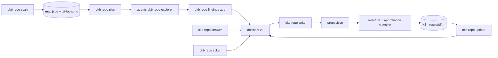

# Repos de code : conception

Objectif : qu’une personne qui ne connaît rien à un repo puisse y travailler vite,
et que la connaissance acquise (onboarding, puis chaque ticket) vive dans une KB
fiable. Le guide utilisateur est [docs/guide/repos.md](../guide/repos.md).

## Principes

1. **D’abord une carte déterministe, ensuite l’IA.** `okb repo scan` inventorie tout
   le repo en quelques secondes, sans exécuter ni réseau : c’est la garantie contre
   « un résumé qui oublie l’important ».
2. **Une liste fixe de 25 questions** (`src/repo/questions.ts`), en six thèmes. Chacune
   finit citée, déduite (marquée) ou **inconnue** avec où chercher et à qui demander.
   Les réponses humaines sont des sources datées, jamais un prérequis.
3. **Le code se cite comme du code** : dossier v3, `file` + `lines` + `quote`. Le noyau
   découpe les extraits, vérifie chaque citation contre le fichier actuel et convertit
   en dossier v2 : rendu, notes de bas de page, fiches concepts, revue et application
   restent ceux de toute la KB.
4. **Les schémas sont ancrés** : `nodes` relie chaque boîte Mermaid à un chemin réel
   ou à `external:<système>` ; une boîte non reliée ou un chemin absent est refusé.
5. **La fraîcheur suit Git** : chaque note garde `x_okb.repo.commit` ; ses sources
   (`<repo>/<chemin>`, `urn:sha256:`) et les ancres d’état disent ce qu’elle cite.
6. **Confidentialité** : une KB `kb.confidential` refuse le web, le wizard ne crée pas de
   GitHub, `okb doctor` signale dossier synchronisé (iCloud, OneDrive…) et remote Git.

## Flux

## Modules (`src/repo/`)

| Fichier | Rôle |
|---|---|
| `registry.ts` | `~/.okb/repos.yaml` : repo → KB ; résolution par chemin (physique), puis par remote après un nouveau clone |
| `git.ts` | lecture seule : identité, fichiers (`ls-files`), historique sur un an, diff, base de branche, commits |
| `inventory.ts` | classement de chaque fichier (doc, manifeste, interface, code, test…) et contenu texte borné |
| `detect.ts`, `interfaces.ts`, `insight.ts` | stack, commandes, docs, CI, tests, publié/exposé/appelé, variables, environnements, entités, modules, propriétaires, points chauds, modules centraux, vocabulaire, risques et divergences doc/code |
| `scan.ts` | assemble la carte, le plan de lecture par niveaux (lire / parcourir / indexer / ignorer, avec budget) et les faits Git citables |
| `questions.ts` | les 25 questions et leurs pistes issues de la carte |
| `dossier.ts` | dossier v3 → extraits exacts + dossier v2 ; ancrage des schémas |
| `notes.ts` | écriture d’une note du pack, trouvailles des agents, réponses humaines |
| `status.ts` | état (notes, couverture, questions) et fraîcheur |
| `ticket.ts` | contexte d’une branche terminée, citable |
| `generated.ts` | notes générées : questions ouvertes, paysage multi-repos |
| `pack.ts` | les sept notes du pack, leurs fichiers et titres |
| `confidential.ts` | dossiers synchronisés, remotes |

Plugin : skills `okb-onboard` et `okb-repo-learn`, agent `okb-repo-explorer`,
commandes `/okb:onboard`, `/okb:ticket`, `/okb:repo`, contexte de repo au démarrage
de session, intentions « je découvre ce repo » et « j’ai fini mon ticket ».

## Ce que le noyau vérifie, et ce qu’il ne vérifie pas

Vérifié : chaque citation existe mot pour mot dans le fichier cité (lignes trouvées
ou corrigées), les fichiers restent dans le repo (ou sont des sources externes
explicites), les nœuds de schéma pointent vers des chemins réels, aucune valeur
secrète n’entre dans une trouvaille, une réponse ou une proposition, le modèle de
note est respecté.

Non vérifié : qu’une citation soutient l’affirmation (rôle du réviseur), qu’un code
se comporte comme il est écrit (OKB n’exécute rien), l’exhaustivité de la lecture
(déclarée par les agents, mesurée et affichée, jamais présumée).

## Choix et limites

- **Une KB de travail, un dossier par repo**, plutôt qu’une KB par repo : vocabulaire
  métier partagé, paysage multi-repos, un seul endroit à relire. Une KB par repo reste
  possible (`okb repo add --kb`).
- **Rien n’est écrit dans le repo de l’entreprise.** Partager la KB avec l’équipe
  (un `docs/` dans le repo) est une évolution possible, sur demande explicite.
- La détection est heuristique (regex et manifestes) : elle oriente la lecture, elle ne
  remplace pas la lecture ; un faux négatif devient une question ouverte, pas un fait.
- Les gros dépôts : plafond de 60 000 fichiers inventoriés, budget de lecture prioritaire
  (80 fichiers, 15 000 lignes) puis zones déléguées ; l’avancement persiste entre sessions.
