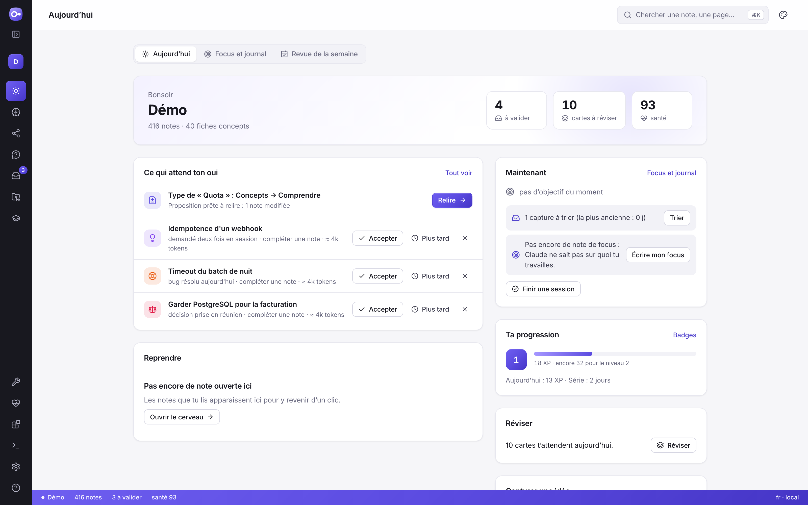
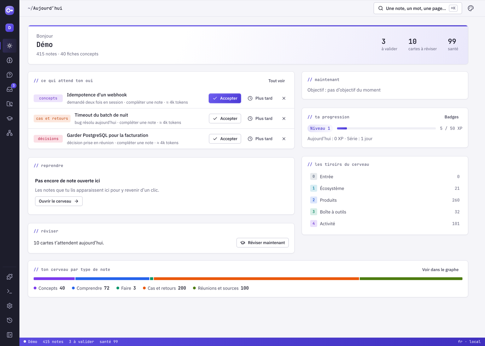
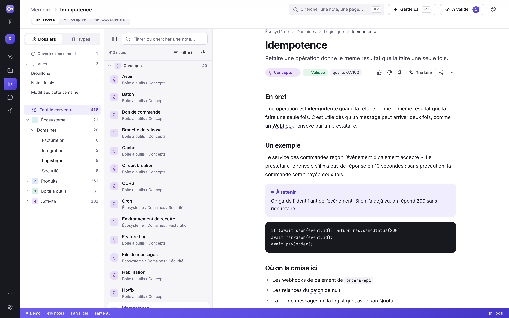
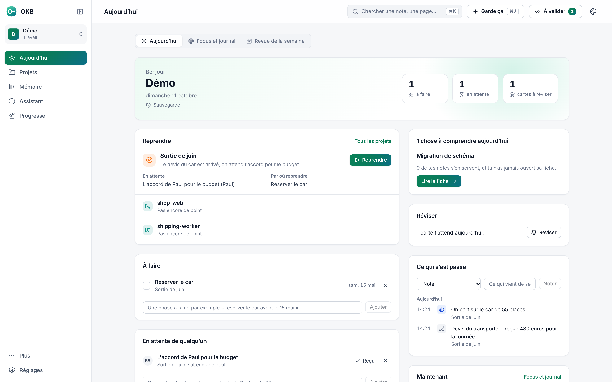
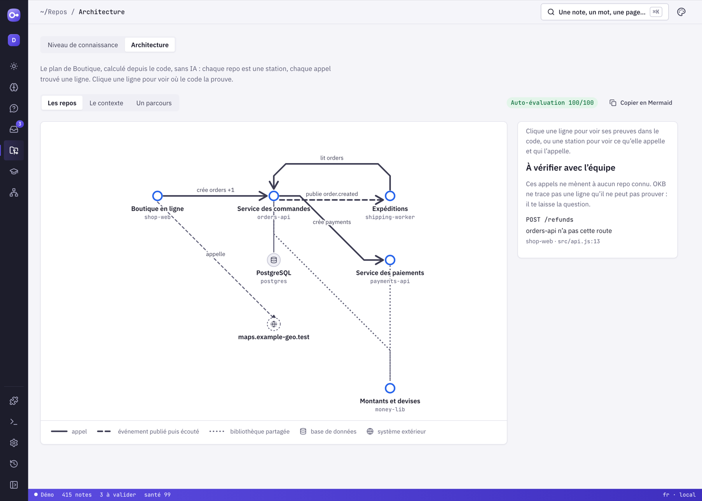
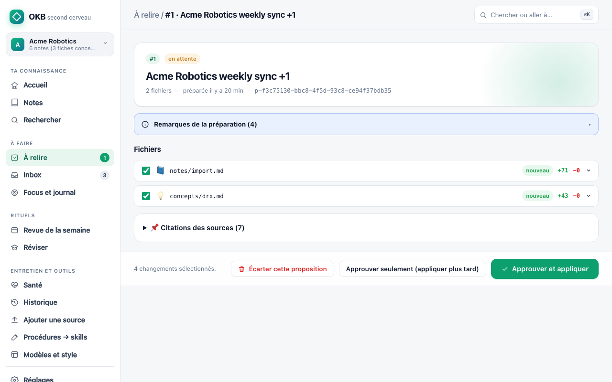
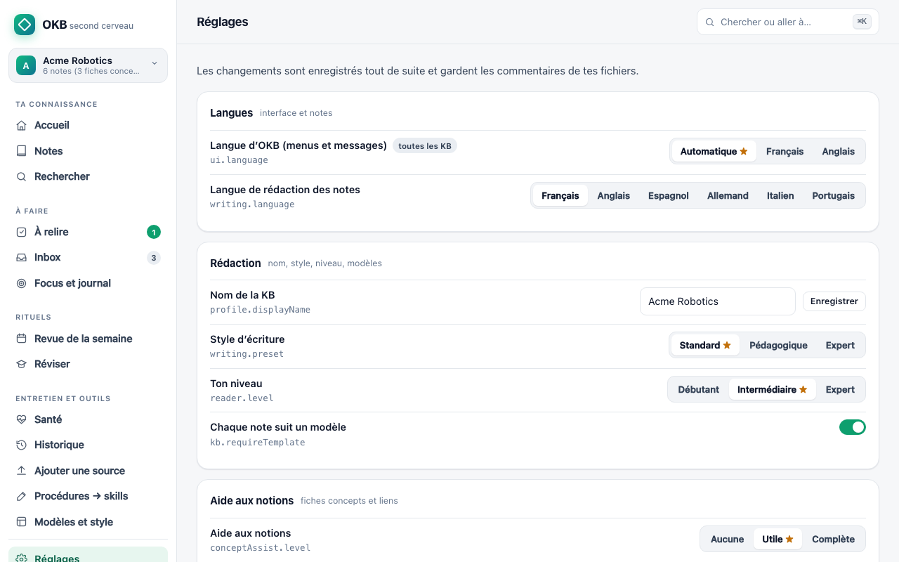
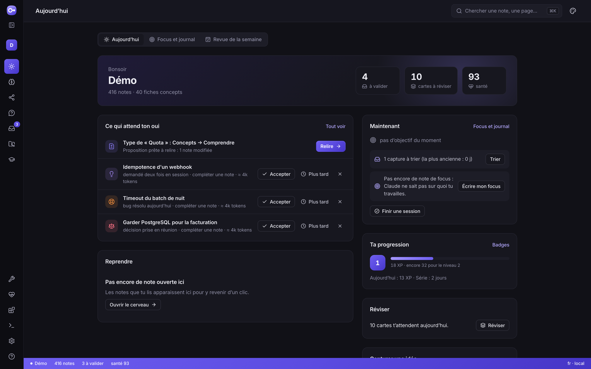

# L’application web

```bash
okb serve
```

La page s’ouvre dans ton navigateur (`http://127.0.0.1:4317`). Elle ne tourne que
sur ton ordinateur : aucun compte, aucun service en ligne. Arrête-la avec Ctrl+C
dans le terminal. Autre port : `okb serve --port 4318` ; sans ouvrir le
navigateur : `okb serve --no-open`.



## Les cinq écrans

La barre de gauche montre cinq écrans. Chacun a ses onglets, et chaque onglet a son
adresse, que tu peux garder en favori.

| Écran | Pour |
|---|---|
| **Aujourd’hui** | l’accueil : ce qui attend ton oui, reprendre une note, ce qui est utile maintenant, ta progression, réviser. Onglets **Focus et journal** (ta note de focus, finir une session, le journal) et **Revue de la semaine** (pas à pas) |
| **Projets** | ce sur quoi tu travailles. Un projet dit **où il en est** en une phrase et sa **prochaine étape**. Tu crées un projet pour un sujet (un cours, une mission, un événement). Avec le module développeur, tes **tickets** et tes **repos** deviennent des projets tout seuls, et les onglets **Repos** (niveau de connaissance, fiche d’un repo) et **Architecture** (calculée depuis le code) apparaissent |
| **Mémoire** | tes notes. Onglet **Notes** : l’explorateur en trois colonnes (détails plus bas). Onglet **Graphe** : toutes les notes et leurs liens, ou le cerveau **vu d’en haut** ([détails](graphe-et-categories.md)). Le graphe montre aussi les notes **à ranger** : celles qui sont hors des tiroirs, et celles que rien ne relie aux autres |
| **Assistant** | onglet **Demander** : une question, les passages de tes notes qui répondent, et sur ton clic une réponse rédigée qui cite chaque passage. Onglet **Dans ton terminal** : brancher OKB sur Claude Code |
| **Progresser** | **Réviser** les cartes (Révéler, puis 1 à 4), ta **Progression** (niveau et badges), ta **Carrière** |

En haut de chaque écran :

- **Chercher** (⌘K) ;
- **Garde ça** (⌘J) : une ligne que tu écris est gardée tout de suite dans tes captures ;
- **À valider**, avec le nombre de choses qui attendent ton oui : les **notes à écrire** que Claude propose (Accepter, Plus tard, Non merci), les **changements prêts** à relire, les **captures** à trier, l’**historique** (annuler le dernier).

En bas de la barre, le menu **Plus** range ce qui n’est pas quotidien :

| Plus | Pour |
|---|---|
| **Outils** | ajouter une source, transformer une procédure en skill, les modèles et ton style, les catégories, **Partager** (un pack pour un collègue, ou recevoir le sien) |
| **Santé** | la santé de tes notes, les sauvegardes, l’utilisation (coûts, qualité), le diagnostic et la mise à jour |
| **Modules** | les modules par métier |
| **Aide** | la visite guidée, le glossaire, les raccourcis, les codes d’erreur |

Les **Réglages** restent à un clic, sous le menu Plus : les réglages, l’apparence, tes cerveaux (ouvrir, connecter un dossier, en créer un).

**⌘K** (ou `/`) cherche une note par quelques mots, fautes et accents pardonnés, ou
t’emmène sur n’importe quelle page ou onglet. Les adresses des versions précédentes
(`#/notes`, `#/graph`, `#/repos`, `#/weekly`, `#/health`…) ouvrent la bonne page dans
le bon écran. L’interface des toutes premières versions (`/classic`) n’existe plus :
son adresse mène à l’application.



### Trouver une note

- **Filtres** (au-dessus de la liste) : un ou plusieurs types, le statut
  (brouillon, validée, dépassée), la qualité (bonnes ★4 et plus, faibles ★2 et
  moins), la date (7 jours, 30 jours, un an), 🔒 seules ou sans 🔒. Ils se
  cumulent ; chacun s’enlève d’un clic.
- **Affichage** : en **liste**, en **tableau** (type, emplacement, qualité, date)
  ou en **cartes** ; grouper par type, par dossier ou pas ; trier par titre, les
  plus récentes ou les meilleures d’abord.
- **Enregistrer la vue** garde le dossier, les filtres et l’ordre sous un nom ;
  trois vues sont prêtes : Brouillons, Notes faibles, Modifiées cette semaine.
- **Épingler** une note (bouton punaise sur la note) la garde en haut de l’arbre,
  avec les notes ouvertes récemment.
- En tableau ou en cartes, coche plusieurs notes : **changer leur type** ou les
  **rendre 🔒** en un seul changement à relire, ou **copier leurs liens**.
- Au clavier : **↑ ↓** dans la liste, **Échap** vide la sélection puis ferme la note.

### Lire une note

Le chemin de la note en haut (chaque étape mène à son dossier), son titre et son
résumé, puis son type (clique pour le changer : un changement à relire est préparé), son
état, ses sources et sa qualité. Les mots qui ont une fiche concept sont soulignés
en pointillé : laisse la souris dessus un instant (ou touche-le sur un téléphone),
une bulle montre la phrase de la fiche et « Lire la fiche → ». En bas : les notes
qui la citent et celles qu’elle cite, et son graphe local. La punaise l’épingle ; le
menu « … » donne ses versions, l’ouverture dans Obsidian et son chemin.

Sous le texte, **Sources et validité** dit :

- d’où vient ce que dit la note : chaque source, et combien de phrases la citent ;
- qui l’a écrite (toi ou l’IA) et quand ;
- quand tu l’as relue et approuvée ;
- jusqu’à quand elle tient, avec une pastille « À revoir » quand sa date est passée.

Le bouton **Vérifier si les sources ont changé** compare les fichiers lus sur cet
ordinateur avec ce qu’ils étaient à la lecture. Une source qui a changé ne rend pas
la note fausse : c’est le signal pour la relire.



### Choisir son apparence

Le menu **Apparence** (en haut à droite, dans Réglages, ou ⌘K) :

- **le thème** : **Atelier** (par défaut), violet, barre latérale sombre et barre
  d’état ; ou **Classique**, vert et clair, l’interface des premières versions ;
- **clair** (par défaut), **sombre** ou **auto** (comme ton système) ;
- **le style** : **dégradé** (par défaut) ou **à plat**, pour tout le site, logo compris ;
- **le logo** : chacune des propositions de logo.

Une seule police partout, Inter ; le code seul est en police à chasse fixe. La
barre de gauche se **replie** en icônes ou se **déplie** avec les textes : le
bouton en haut de la barre, ou **⌘\\** (Ctrl+\\). Tes choix sont retenus par ton
navigateur.





## Raccourcis

- **⌘K** (ou **/**) : chercher une note ou aller n’importe où.
- **⌘J** : « Garde ça », depuis n’importe quel écran.
- **⌘\\** (Ctrl+\\) : replier ou déplier la barre de gauche.
- **⌘↵** : capturer depuis le champ des captures.
- **Espace**, puis **1** à **4** : révéler une carte, puis dire comment ça s’est passé.
- Dans Mémoire : **↑ ↓** pour passer d’une note à l’autre, **Échap** pour vider la
  sélection, puis fermer la note.

## Relire et approuver



Ouvre un changement dans **À valider › Changements prêts** : chaque fichier montre ses
lignes ajoutées et retirées, ou son aperçu, et les vérifications à droite. Décoche
les fichiers que tu ne veux pas garder, puis :

- **Approuver et appliquer** : le changement est écrit dans tes notes ;
- **Approuver sans appliquer** : pour l’écrire plus tard ;
- **Écarter** : le changement est abandonné, tes notes ne changent pas.

Pour approuver, OKB vérifie que c’est bien **toi** : sur macOS, une fenêtre de
confirmation apparaît sur ton écran ; ailleurs, la question est posée dans le
terminal où tourne `okb serve`. Un programme ou un agent qui piloterait la page ne
peut pas répondre à ta place. Si aucune des deux n’est possible, la page affiche la
commande à lancer toi-même (`okb review 1`).

Si tes notes ont changé depuis la préparation du changement (tu as modifié une note
dans Obsidian, par exemple), la page refuse l’aperçu : le changement doit être
préparé à nouveau. Tes modifications ne sont jamais écrasées.

## Réglages



Dans **Réglages** (onglet Général), groupés par thème.

Chaque réglage est enregistré tout de suite et s’applique sans redémarrer.
La valeur recommandée porte une ★. Le nom technique (par exemple
`writing.language`) est le même que dans `okb settings`.

## En mode sombre



## Sécurité, en bref

La page n’écoute que ton ordinateur, refuse les requêtes venant d’autres sites et
n’exécute jamais le contenu de tes notes. Les détails sont dans
[la documentation technique](../dev/WEB-APP.md).
