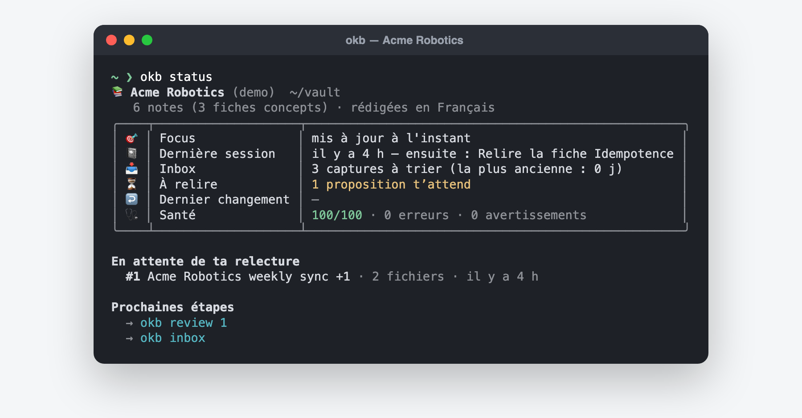

# Au quotidien

## Le réflexe : dire ce que tu veux

Dans Claude Code, inutile de connaître les commandes. Quand ton message ressemble
à une tâche OKB, OKB propose de s’en occuper avec un bouton à valider :

| Tu dis… | OKB propose |
|---|---|
| « ok fin de session », « on s’arrête là » | finir la session : résumé, ce qui mérite d’être gardé, la suite (`/okb:done`) |
| « lis ce transcript », « ajoute ce PDF à ma KB » | importer la source et préparer des notes (`/okb:ingest`) |
| « note ça : relancer Sam sur le budget » | capturer dans ton inbox (`/okb:capture`) |
| « que dit ma KB sur l’idempotence ? » | chercher dans tes notes, avec les passages exacts (`/okb:ask`) |
| « mets à jour mon focus » | réécrire ta note de focus (`/okb:focus`) |
| « interroge-moi sur cette fiche » | réviser par questions (`/okb:learn`) |
| « fais ma revue de la semaine » | la revue guidée (`/okb:weekly`) |
| « transforme cette procédure en skill » | un brouillon de skill Claude (`/okb:skillify`) |

Tu gardes la main : OKB **propose**, il ne lance rien sans ton clic. Si une autre
base de connaissances est installée (par exemple l’agent support de ton équipe et
sa KB), OKB ne se propose pas pour elle : il te demande d’abord laquelle tu vises,
et n’écrit jamais chez elle.

Tape `/okb` pour ouvrir le panneau OKB (état, raccourcis), ou `/okb:menu`.

## Les gestes de base

### Capturer une idée

Une idée, un lien, une phrase à retenir : elle va dans ton **inbox privée**, pas
encore dans la KB. Tu décideras plus tard.

```bash
okb capture "Comparer le dispatcher avec une file de messages"
okb inbox        # trier, une capture à la fois
```

### Importer une source

Transcription de réunion (VTT), document (PDF avec texte, DOCX, Markdown), page web,
code. Le mieux : demande à Claude « lis ce transcript » en donnant le fichier.
Claude écrit des notes sourcées ; OKB vérifie chaque citation et prépare une
**proposition**.

Sans Claude, l’application web (« Ajouter une source ») garde la source dans ton
inbox, ou prépare un extrait brut fait de citations.

### Relire et approuver

```bash
okb review       # la liste de ce qui t’attend
okb review 1     # la proposition n°1 : changements, fichier par fichier
```

Tu lis les différences, gardes ce qui te sert, puis approuves. L’approbation
applique les changements et, si l’historique Git est actif, crée un commit. Dans
l’application web, le bouton « Approuver et appliquer » te demande une
confirmation sur ton écran.

Claude ne peut pas approuver à ta place : c’est voulu.

### Annuler

```bash
okb undo         # annule le dernier changement appliqué, exactement
okb undo --list  # l’historique
```

### Finir une session

```bash
okb done
```

Trois questions : ce que tu as fait, ce qui mérite d’être gardé (envoyé dans ton
inbox), et la prochaine étape. La prochaine session, Claude lit ton focus et cette
« prochaine fois » pour reprendre directement.

### Le focus

Une note courte : sur quoi tu travailles, ce que tu veux apprendre, ta prochaine
échéance. Claude la lit au début de chaque session.

```bash
okb focus                  # l’afficher
okb focus set "…"          # la réécrire
```

## Les rituels

| Quand | Quoi | Commande |
|---|---|---|
| chaque jour | capturer, relire ce qui attend | `okb`, `okb review` |
| fin de session | ne rien perdre | `okb done` |
| chaque semaine (20 min) | inbox, propositions, relecture espacée (J+1, 7, 30, 90), focus, santé | `okb weekly` |
| quand tu veux | réviser une notion | `/okb:learn` ou « Réviser » dans la page |
| de temps en temps | liens cassés, notes anciennes, doublons | `okb maintain` |



## Toutes les commandes

`okb help` les liste par usage ; `okb help <commande>` donne des exemples.
Les plus utiles :

| | |
|---|---|
| `okb` | le menu |
| `okb status` | où j’en suis (aussi `--brief` pour une ligne) |
| `okb ask "…"` | chercher dans mes notes |
| `okb open <note>` | ouvrir une note dans Obsidian |
| `okb serve` | l’application web |
| `okb kb` | mes KB : changer, connecter un dossier (`add`), retirer (`remove`), convertir (`convert`) |
| `okb settings` | les réglages |
| `okb doctor` | tout vérifier |
| `okb explain <code>` | comprendre un code d’erreur |
| `okb glossary` | le vocabulaire d’OKB |
| `okb completion zsh` | l’autocomplétion du terminal |

Raccourcis : `-V` version, `-v` détaillé, `-q` silencieux, `-y` oui à tout,
`-k <kb>` pour viser une autre KB le temps d’une commande.
