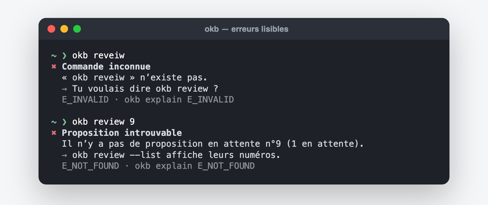

# Dépannage

## Le premier réflexe

```bash
okb doctor          # tout vérifier
okb doctor --fix    # réparer ce qui peut l’être (plugin, commande okb, focus…)
```

Chaque erreur d’OKB dit **ce qui s’est passé**, **pourquoi**, et **quoi faire**,
avec un code à la fin, par exemple `E_STALE`. Pour en savoir plus sur un code :

```bash
okb explain E_STALE
```

ou la rubrique **Aide** de l’application web.



## Les situations les plus courantes

| Message | Ce que ça veut dire | Quoi faire |
|---|---|---|
| **La KB a changé entre-temps** (`E_STALE`) | une note a été modifiée depuis la préparation de la proposition ; OKB refuse d’écraser ton travail | demande à Claude de préparer à nouveau la proposition |
| **Pas encore approuvée** (`E_NOT_APPROVED`) | on a tenté d’appliquer sans ton accord | `okb review <n>` et approuve toi-même |
| **Écriture interdite à cet endroit** (`E_FORBIDDEN_PATH`) | le dossier n’appartient pas à cette KB, ou contient les notes d’un autre outil | choisis un autre dossier, ou adopte-le explicitement (`okb kb adopt`) |
| **Un secret a été refusé** (`E_SECRET`) | un mot de passe, une clé ou un jeton a été détecté | retire-le du texte ; OKB n’enregistre jamais de secret |
| **Source non prise en charge** (`E_UNSUPPORTED`) | PDF scanné, page qui n’existe qu’en JavaScript… | fournis une version texte (export, copie) |
| **Cette note doit suivre un modèle** | la KB demande un modèle pour chaque note | laisse Claude écrire la note, ou désactive `kb.requireTemplate` |
| **Aucune KB pour l’instant** | OKB n’est pas encore configuré | `okb init` |
| **OKB ne répond pas** (page web) | `okb serve` a été arrêté ou redémarré | relance `okb serve`, puis recharge la page |

## Annuler une erreur de ta part

Un changement appliqué par erreur s’annule exactement :

```bash
okb undo
```

Seul le dernier changement s’annule directement ; `okb undo --list` montre
l’historique. Si tu as modifié la note entre-temps, OKB refuse plutôt que
d’écraser ta modification.

## Claude ne propose pas OKB

- Vérifie que le plugin est installé : `okb doctor` (ligne « Plugin dans Claude »),
  puis ouvre une **nouvelle** session Claude.
- Vérifie que les propositions sont actives : `okb settings show` →
  `routing.suggest`.
- Tu peux toujours utiliser les commandes : `/okb:done`, `/okb:ingest`…

## La commande `okb` est introuvable

`okb doctor --fix` propose de créer une petite commande `okb` dans un dossier déjà
présent dans ton PATH (sans modifier tes fichiers de shell). Sinon, depuis le
dossier d’OKB : `node dist/cli/index.js …`.

## Plusieurs versions de Node

`node --version` et le Node utilisé par npm peuvent différer. Vérifie :

```bash
npm exec -- node --version
```

Il faut 22.13 ou plus. Avec nvm : `nvm use 22`.

## Le plugin et le moteur n’ont pas la même version

OKB te prévient (« plugin 0.4.0, moteur 0.5.0 »). `okb update` remet les deux à
niveau ; ouvre ensuite une nouvelle session Claude.

## Toujours bloqué ?

`okb doctor --json` et `okb status --json` donnent un état complet à joindre à une
demande d’aide. Ils ne contiennent pas le texte de tes notes, mais ils contiennent
des chemins de ton ordinateur : relis-les avant de les partager.
