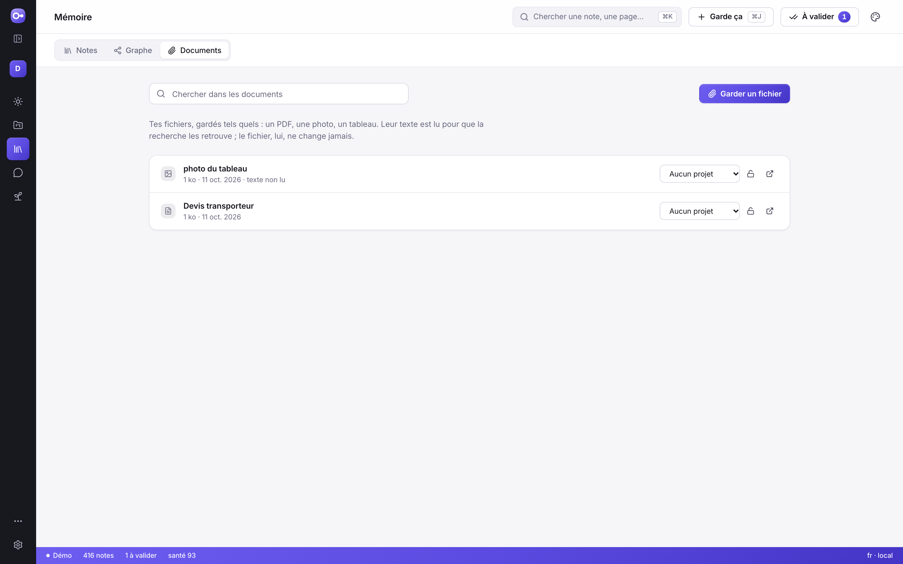

# Les documents : garder un fichier tel quel

Un devis en PDF, une présentation, un mail, une photo de tableau : tu veux le
retrouver, pas le recopier. OKB le garde **tel quel** et lit son texte pour que
la recherche le retrouve.

## Garder un fichier

| Où | Comment |
|---|---|
| Dans l'application | **Mémoire › Documents** : glisse le fichier sur la page, ou clique sur **Garder un fichier** |
| Depuis un projet | la zone **Documents** du projet : le fichier est relié à ce projet |
| N'importe où | **Garde ça** (⌘J), puis **Joindre un fichier** |
| Dans le terminal | `okb doc add <fichier>` (avec `--project <projet>` et `--title "<titre>"` si tu veux) |

Le fichier est copié une fois dans tes notes, dans `_Documents/<année>/`, sous son
nom. Il n'est jamais modifié. L'original reste où il était.

- Le même fichier gardé deux fois n'est gardé qu'une fois.
- Deux fichiers différents du même nom cohabitent (`notes.txt`, `notes-2.txt`) :
  rien n'est écrasé.
- Taille maximale : 20 Mo.

## Le retrouver

La recherche (⌘K, **Chercher**, `okb find`) cherche aussi dans le texte des
documents. Les accents et les majuscules ne comptent pas : « reservation » trouve
« Réservation ».

- **Mémoire › Documents** a sa propre recherche, et montre le passage trouvé.
- `okb doc find <mots>` fait la même chose dans le terminal ; `okb doc` liste tout.

OKB lit le texte des PDF qui en contiennent, des documents Word, des
présentations, des tableurs, des mails et des fichiers texte. Pour une photo ou
un enregistrement, il n'y a pas de texte à lire : le fichier est gardé quand
même, et sa ligne le dit (« texte non lu »). Tu le retrouves par son titre.

## L'ouvrir, le relier, le cacher

- **Ouvrir** : un clic sur le titre ouvre le fichier avec l'application de ton
  ordinateur. Si rien ne peut l'ouvrir, OKB t'indique où il se trouve.
- **Relier à un projet** : choisis le projet sur la ligne du document.
- **Cacher aux assistants** : le cadenas. Un document 🔒 n'apparaît plus dans les
  recherches de Claude ni des assistants branchés par MCP. Toi, tu le vois
  toujours.

## Ce qu'un assistant peut faire

Chercher dans tes documents, oui. En garder un, le renommer ou lever un cadenas,
non : ce sont tes gestes, dans l'application ou le terminal.

## À savoir

- Un document n'est pas une note : il ne compte pas dans la santé de tes notes et
  n'apparaît pas dans le graphe.
- Garder un fichier ne passe pas par « À valider » : c'est toi qui le déposes, il
  n'y a rien à relire.
- Le dossier `_Documents/` fait partie de tes notes : il part avec elles dans une
  sauvegarde. La liste des documents et le texte lu sont dans la base d'état de
  ton profil (`okb.db`).
