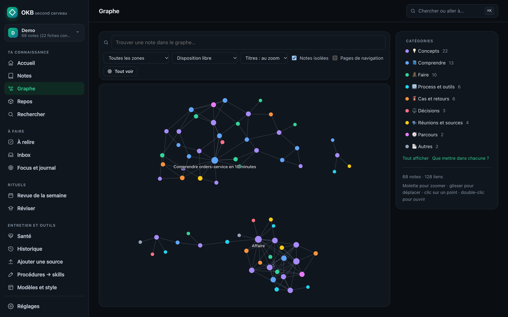

# Le graphe et les catégories

Ta KB va grandir : des centaines de notes, plusieurs sujets, plusieurs repos.
Deux outils t'aident à t'y retrouver :

- **les catégories**, qui donnent à chaque note une couleur selon ce qu'elle
  contient ;
- **le graphe**, qui montre toutes tes notes et les liens entre elles.

## Les catégories

Chaque note appartient à une seule catégorie. Sa couleur est la même partout :
dans le graphe, la liste des notes, la recherche, la relecture des propositions
et le terminal.

| | Catégorie | Ce qu'on y range | Modèles |
|---|---|---|---|
| 🟣 | 💡 **Concepts** | une notion expliquée en une minute | `concept` |
| 🔵 | 📘 **Comprendre** | comment marche un sujet ou un système | `guide`, et l'aperçu, l'architecture, les interfaces et la carte du code d'un repo |
| 🟢 | 🪜 **Faire** | les procédures à suivre et les **tutos** pour apprendre en faisant | `procedure`, `tutorial`, et « démarrer » et « livrer » d'un repo |
| 🩵 | 🔁 **Process et outils** | comment l'équipe travaille, les outils, ce qui est automatisé | `process`, `tool`, `automation` |
| 🟠 | 🧯 **Cas et retours** | ce qui s'est vraiment passé : **cas clients**, incidents, tickets | `experience`, `client-case`, ticket d'un repo |
| 🔴 | ⚖️ **Décisions** | un choix et ses raisons | `decision` |
| 🟡 | 🗣️ **Réunions et sources** | l'essentiel d'une réunion, d'une vidéo, d'un document | `meeting` |
| 🩷 | 🧭 **Parcours** | quelles notes lire, dans quel ordre, pour maîtriser un sujet | `path` |
| ⚪ | 📄 **Autres** | les notes écrites sans modèle | — |

**Personne n'a à ranger quoi que ce soit.** Quand Claude prépare une note, il
choisit un modèle adapté (un tuto, un cas client, une décision…). Ce modèle
décide de sa catégorie et de son dossier (`tutos/`, `cas-clients/`,
`decisions/`…). Pour une note écrite à la main, la catégorie se déduit dans
cet ordre :

1. un choix explicite (`x_okb.category`) ;
2. le modèle ;
3. le type ;
4. le dossier.

Trois modèles sont nouveaux :

- **tuto** : apprendre à faire une chose en comprenant chaque étape ;
- **cas client** : le client et son contexte, le besoin, ce qui a été fait, les
  résultats, ce qu'on en retient ;
- **parcours** : un chemin de lecture vers d'autres notes, dans le bon ordre.

### Changer la catégorie d'une note

- Dans l'application web, clique sur la pastille de catégorie en haut de la
  note, puis choisis la nouvelle.
- Dans le terminal :

```bash
okb categories set brouillons/idees.md guide
```

Comme tout changement, cela prépare une **proposition** que tu approuves. Le
texte de la note ne change pas. Avec `auto`, la note redevient classée par son
modèle.

`okb categories` montre la répartition de ta KB et les notes sans catégorie.
`okb maintain` les signale aussi.

### Tes propres catégories

Une KB peut renommer, recolorer ou ajouter des catégories dans
`.okb/categories.yaml`. Par exemple, pour séparer les clients des incidents :

```yaml
categories:
  - id: client
    label: { fr: Clients, en: Clients }
    emoji: "🏢"
    color: "#0f766e"
    templates: [client-case]
    folders: [clients]
```

Une catégorie qui prend un modèle, un type ou un dossier le retire de celle qui
l'avait.

## Le graphe



Dans l'application web (`okb serve`), page **Graphe** :

- **chaque point est une note**, coloré par catégorie, plus gros quand la note
  est très reliée ;
- **chaque trait est un lien** d'une note vers une autre ; les pointillés
  marquent un prérequis (« à lire avant ») ;
- **molette** pour zoomer, **glisser** pour te déplacer, glisser un point pour le
  bouger ;
- **survoler** un point allume ses voisins ; **cliquer** ouvre un panneau (résumé,
  notes reliées) ; **double-cliquer** ouvre la note ;
- **« Son voisinage »** ne garde que la note et ce qui l'entoure (à 1, 2 ou 3 liens) ;
- **la légende** masque ou affiche une catégorie d'un clic ;
- **filtres** : une zone (un dossier ou un repo), les notes isolées, les pages de
  navigation ;
- **regrouper** par catégorie ou par zone, pour voir les grandes masses ;
- **la recherche** allume les notes trouvées et va sur celle que tu choisis.

Sous chaque note, le **graphe local** montre ses voisins. Les listes **« Cité
par »** et **« Liens vers »** donnent les liens exacts, lus dans le texte des
notes.

## Et Obsidian ?

L'application web fait maintenant tout ce dont tu as besoin au quotidien :

- lire, chercher, voir le graphe ;
- relire et approuver ;
- réviser, faire la revue de la semaine.

Obsidian devient **facultatif**. Il reste utile si tu veux :

- écrire une note à la main avec un vrai éditeur ;
- lire tes notes sur téléphone avec la synchronisation d'Obsidian ;
- utiliser ses plugins (canvas, cartes mentales…).

Tes notes sont de simples fichiers Markdown : tu peux arrêter ou reprendre
Obsidian quand tu veux, rien ne change pour OKB.
