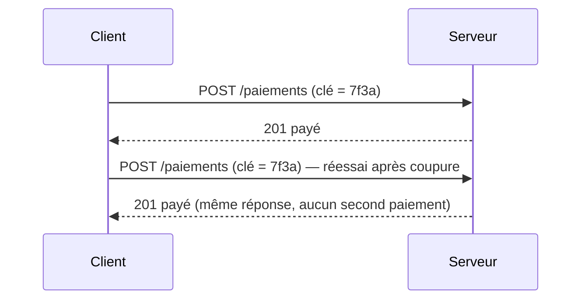

🧭 [🧠 Travail](../../Accueil.md) › [Boîte à outils](../Bo%C3%AEte%20%C3%A0%20outils.md)

# Idempotence

**En une phrase.** Une opération est idempotente quand la refaire ne change plus rien : une, deux ou dix fois, le résultat est le même.

> 💡 **Analogie.** Appuyer sur le bouton d'appel d'un ascenseur : le premier appui l'appelle, les suivants ne l'appellent pas une deuxième fois. *L'analogie s'arrête là : un ascenseur ne renvoie pas de réponse à chaque appui.*

## 🔍 Comment ça marche

Le serveur reconnaît une demande déjà traitée grâce à une **clé d'idempotence** envoyée avec elle, et renvoie la réponse déjà calculée au lieu de recommencer.

## 💡 Exemple chez nous

Dans Atlas, `POST /orders/{id}/pay` exige un en-tête `Idempotency-Key` (`atlas-api/src/payments/pay.ts:18`) : un client qui réessaie après une coupure réseau ne paie pas deux fois.

## 🚧 Pièges

- `GET` et `PUT` sont idempotents par définition ; `POST` ne l'est que si on le rend idempotent.
- La clé doit être conservée assez longtemps pour couvrir les réessais (24 h dans Atlas).
- À ne pas confondre avec une opération *sans effet* : la première exécution, elle, change bien l'état.

**Voir aussi** : [Retry exponentiel](Retry%20exponentiel.md) · [Transaction](Transaction.md)
