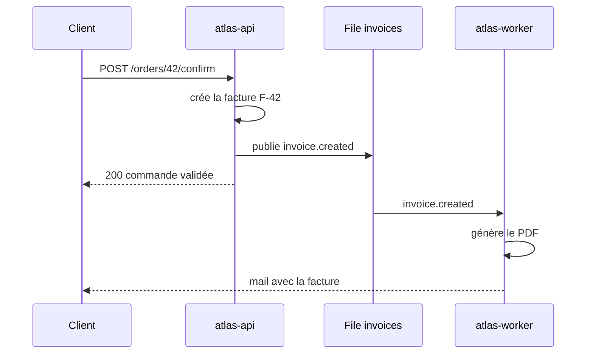

🧭 [🧠 Travail](../../../Accueil.md) › [Produits](../../Produits.md) › [Atlas](../Atlas.md)

# Atlas — Flux d'une facture

## ⚡ En bref

Quand une commande est validée, `atlas-api` crée la facture, la met dans la file `invoices` et `atlas-worker` l'envoie par mail. À retenir : la facture existe dès la validation, l'envoi peut arriver plus tard.

## ▶️ Ce qui déclenche

Le client clique sur « Valider la commande » : le front appelle `POST /orders/{id}/confirm` [^c1].

## 🔁 Le déroulé

## 🪜 Étape par étape

1. **Validation** — `src/orders/confirm.ts:18` vérifie le stock puis passe la commande à `confirmed` [^c1].
2. **Facture** — `src/billing/invoice.ts:30` crée la facture avec un numéro continu (une [règle comptable](../Fonctionnel/Atlas%20—%20Numérotation%20des%20factures.md)).
3. **File** — l'événement `invoice.created` part dans la file ; la réponse au client n'attend pas l'envoi.
4. **Envoi** — `atlas-worker` génère le PDF et l'envoie (`src/jobs/send-invoice.ts:12`) [^c2].

## 🚨 Quand ça casse

| Symptôme | Cause probable | Où regarder |
|---|---|---|
| Commande validée, pas de mail | le worker est arrêté ou la file bloquée | tableau de bord de la file `invoices` |
| Deux factures pour une commande | un double clic avant la correction ABC-87 | [ABC-87 — Double facture](../Code/atlas-api/Tickets/2026/ABC-87%20—%20Double%20facture.md) |

[^c1]: `atlas-api/src/orders/confirm.ts:18-41`
[^c2]: `atlas-worker/src/jobs/send-invoice.ts:12-30`
