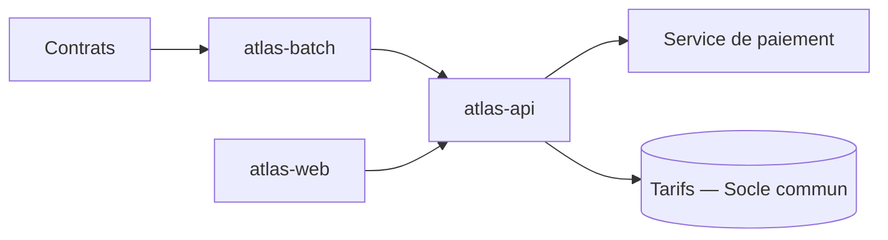

🧭 [🧠 Travail](../../Accueil.md) › [Produits](../Produits.md)

# Atlas

## ⚡ En bref

Atlas transforme les contrats en factures, chaque mois, et suit leur paiement. Trois repos : l'API (`atlas-api`), l'écran des gestionnaires (`atlas-web`) et le batch de nuit (`atlas-batch`). À retenir : tout montant passe par le moteur de tarifs du [Socle commun](../Socle%20commun/Socle%20commun.md).

## 🎯 À quoi ça sert, pour qui

Les gestionnaires de facturation s'en servent pour émettre et corriger les factures ; la comptabilité lit ses exports. Sans Atlas, les factures seraient calculées à la main à partir des contrats.

## 🔍 Comment ça marche

1. Chaque nuit, `atlas-batch` lit les contrats actifs et calcule les montants du mois.
2. `atlas-api` émet les factures et les envoie au service de paiement.
3. Les gestionnaires corrigent et valident dans `atlas-web`.

## 🧭 Sa place

- **Au-dessus** : l'[Écosystème](../../1%20%C3%89cosyst%C3%A8me/%C3%89cosyst%C3%A8me.md) et le domaine [Facturation](../../1%20%C3%89cosyst%C3%A8me/Domaines/Facturation/Facturation.md).
- **À côté** : [Boréal](../Bor%C3%A9al/Bor%C3%A9al.md) envoie les livraisons qu'Atlas facture.
- **En dessous** : les repos [atlas-api](Code/atlas-api/atlas-api.md), [atlas-web](Code/atlas-web/atlas-web.md), [atlas-batch](Code/atlas-batch/atlas-batch.md).

## 🔤 Les 5 mots à connaître

| Mot | En une ligne |
|---|---|
| [Avoir](../../1%20%C3%89cosyst%C3%A8me/Domaines/Facturation/Avoir.md) | une facture négative qui annule tout ou partie d'une autre |
| [Échéance](../../1%20%C3%89cosyst%C3%A8me/Domaines/Facturation/%C3%89ch%C3%A9ance.md) | la date à laquelle le client doit payer |
| [Idempotence](../../3%20Bo%C3%AEte%20%C3%A0%20outils/Concepts/Idempotence.md) | refaire un paiement ne paie pas deux fois |
| [TVA](../../1%20%C3%89cosyst%C3%A8me/Domaines/Facturation/TVA.md) | la taxe ajoutée au montant hors taxe |
| [Lot](../../3%20Bo%C3%AEte%20%C3%A0%20outils/Concepts/Lot.md) | un paquet de contrats traités ensemble par le batch |

## 💡 À retenir et pièges

1. Une facture émise ne se modifie jamais : on émet un avoir.
2. Le batch traite par lots de 500 contrats ; un lot qui échoue se relance seul.
3. Les montants arrondis le sont ligne par ligne, pas sur le total.

## ➡️ Pour aller plus loin

1. [Atlas — Contexte et place](Architecture/Atlas%20%E2%80%94%20Contexte%20et%20place.md)
2. [Émettre une facture](Fonctionnel/%C3%89mettre%20une%20facture.md)
3. [atlas-api](Code/atlas-api/atlas-api.md), puis [atlas-api — Démarrer](Code/atlas-api/atlas-api%20%E2%80%94%20D%C3%A9marrer.md)

## ❓ Ce qu'on ne sait pas encore

- Qui décide des règles d'arrondi ? (à demander à l'équipe Facturation)
