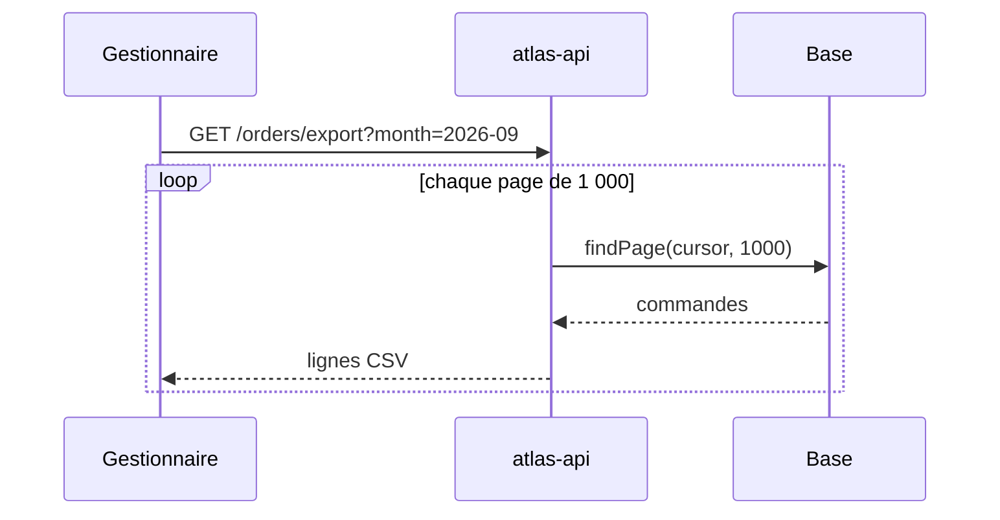

🧭 [🧠 Travail](../../../../../../Accueil.md) › [Produits](../../../../../Produits.md) › [Atlas](../../../../Atlas.md) › [atlas-api](../../atlas-api.md)

# ABC-123 — Export CSV des commandes

## ⚡ En bref

L'export CSV coupait silencieusement les fichiers au-delà de 10 000 lignes. Il lit maintenant les commandes par pages de 1 000 et écrit au fil de l'eau. À retenir : un export ne doit jamais charger toute la table en mémoire.

## 🎯 Le problème en simple

Un gestionnaire exporte les commandes du mois pour les rapprocher de la comptabilité. Le fichier s'arrêtait à 10 000 lignes sans message, alors que le mois en comptait 14 200 [^t1]. Rien n'indiquait qu'il manquait des lignes : c'est ce qui rendait le bug dangereux.

## 🛠️ La résolution

- `src/export/orders.ts:42` lisait `findAll({ limit: 10000 })` : la limite venait d'une ancienne protection contre les dépassements de mémoire [^c1].
- L'export lit maintenant par pages avec `findPage(cursor, 1000)` et écrit chaque page dans le flux de réponse (`src/export/orders.ts:40-71`) [^c2].
- La réponse est envoyée en `text/csv` avec `Transfer-Encoding: chunked` : le navigateur reçoit le début du fichier tout de suite.

## 🧭 La méthode suivie

1. Reproduire avec un jeu de données de 15 000 commandes (`npm run seed -- --orders 15000`).
2. Chercher toutes les limites codées en dur : `grep -rn "limit:" src/export`.
3. Remplacer le chargement complet par une lecture paginée, sans changer le format du fichier.
4. Vérifier le nombre de lignes du fichier contre un `COUNT(*)`.

Cette méthode est remontée dans la boîte à outils : [Déboguer un export incomplet](../../../../../../3%20Bo%C3%AEte%20%C3%A0%20outils/M%C3%A9thodes/D%C3%A9boguer%20un%20export%20incomplet.md).

## 🧪 Comment c'est testé

`test/export/orders.test.ts` génère 12 500 commandes et vérifie que le CSV en contient 12 500, plus l'en-tête [^c3].

## 💡 Ce que j'ai appris

- ⚠️ Piège : une limite « de sécurité » cachée dans une requête coupe des données sans erreur. → ajouté à [atlas-api — Déboguer](../../atlas-api%20%E2%80%94%20D%C3%A9boguer.md).
- La [pagination par curseur](../../../../../../3%20Bo%C3%AEte%20%C3%A0%20outils/Concepts/Pagination%20par%20curseur.md) évite de relire les mêmes lignes quand la table change pendant l'export.

## 🛗 Ce qui est remonté

| Leçon | Où |
|---|---|
| La méthode d'enquête | Boîte à outils › Méthodes |
| Le piège de la limite cachée | atlas-api — Déboguer |

[^t1]: Ticket ABC-123, description du rapporteur.
[^c1]: `src/export/orders.ts:42`, avant le correctif.
[^c2]: `src/export/orders.ts:40-71`, état final.
[^c3]: `test/export/orders.test.ts:8-35`.
